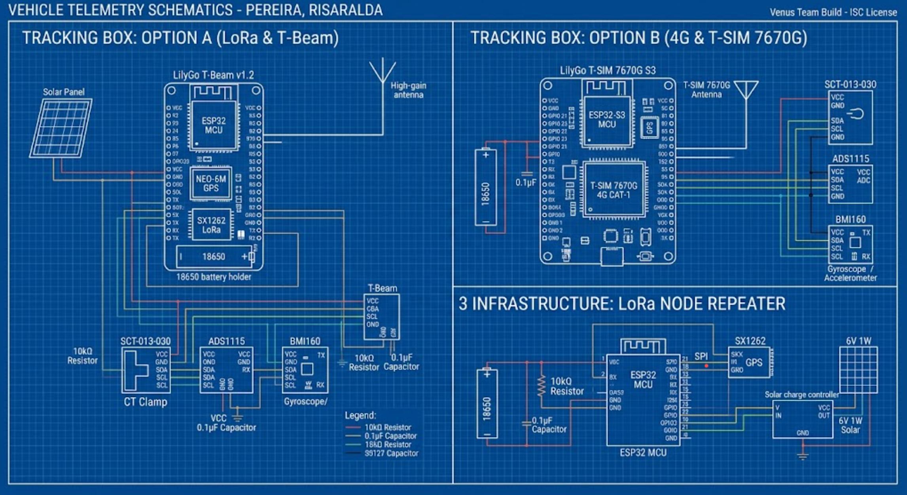
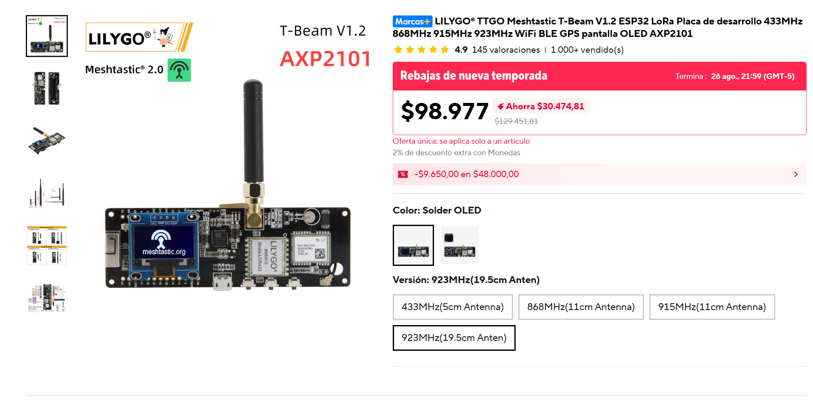
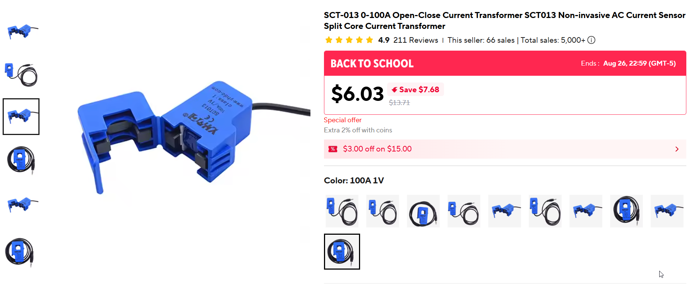
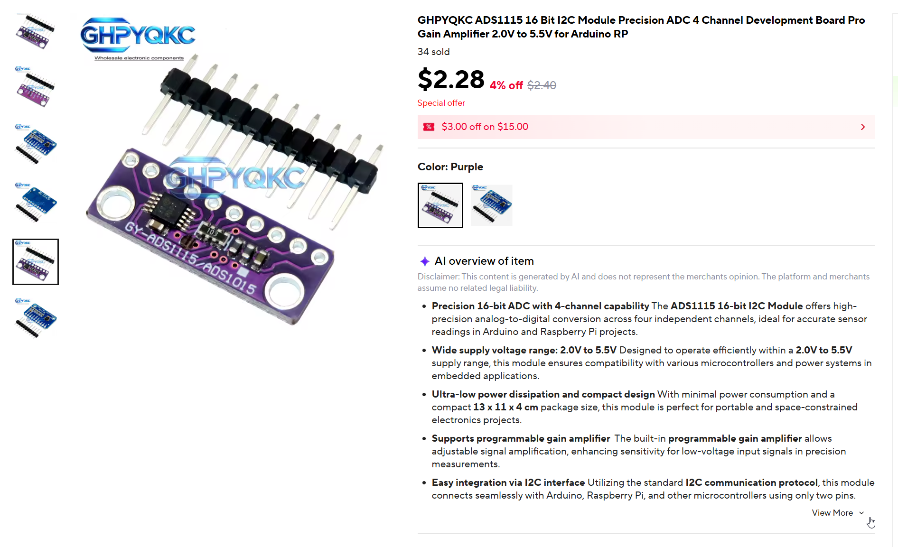
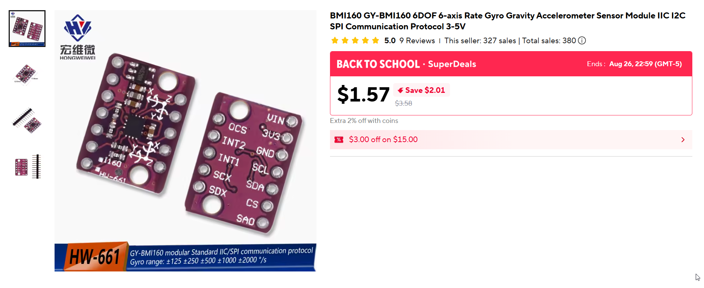
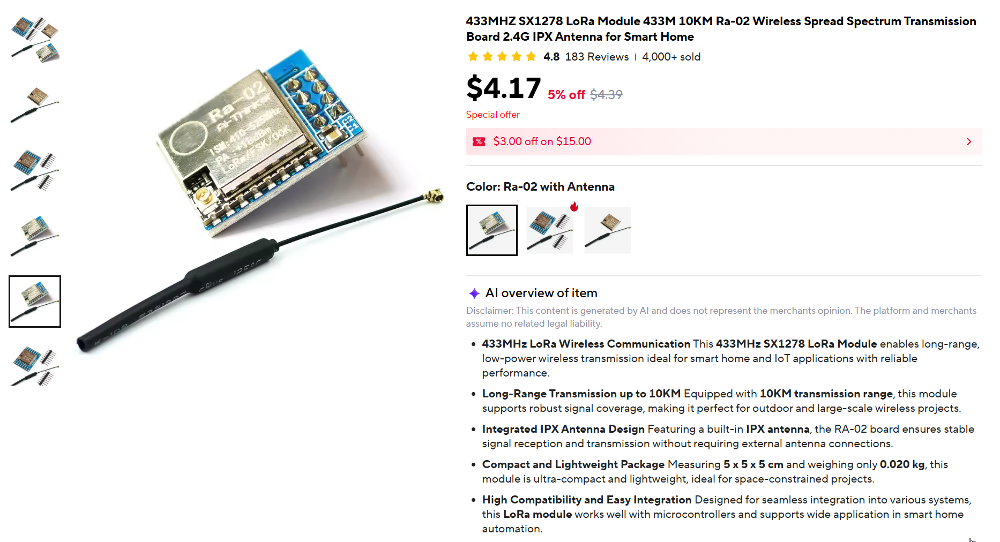
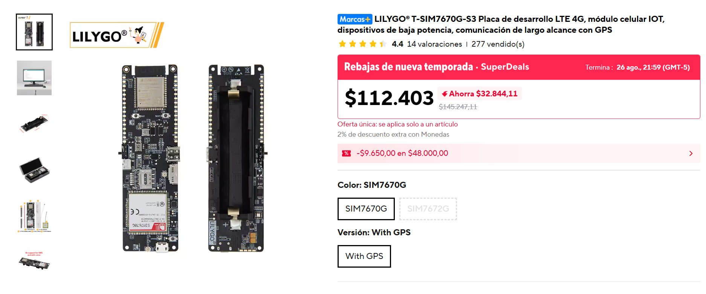

# 🚛 Telemetría IoT Vehicular — Pereira, Risaralda

🌐 [English](README.md)

> Telemetría vehicular en tiempo real usando CT Clamp + Giroscopio + GPS con conectividad LoRa Mesh y 4G LTE.

[]()
[]()
[](https://0xraphael.com/college/iot-vehicle-telemetry)
[](https://0xraphael.com/college/iot-vehicle-telemetry/dashboard-3d.html)

## 📋 Resumen

| Característica | Descripción |
|----------------|-------------|
| **Monitoreo de Corriente** | CT Clamp (SCT-013-030) — 30A máx, amperios/voltaje/FP |
| **Seguimiento de Movimiento** | Giroscopio BMI160 — pitch, roll, yaw, vibración |
| **Rastreo GPS** | NEO-6M / T-Beam integrado — posición, velocidad, rumbo |
| **Doble Conectividad** | LoRa Mesh (gratis) + 4G LTE (respaldo) |
| **Dashboard en Tiempo Real** | Supabase Realtime + Vue/React |
| **Visualización 3D** | Terreno Three.js + marcadores de vehículos |

---

## 🔌 Diagramas de Circuito

> Esquema de cableado para el CT Clamp, giroscopio BMI160, ADC ADS1115 y nodo LoRa ESP32/T-Beam.



---

## 📦 Lista de Materiales — Componentes Detallados

### 🟢 Nodo LoRa (Unidad Vehicular) — ~$48.50

> Una unidad autónoma instalada por vehículo. Recolecta telemetría y transmite vía LoRa mesh.

#### 1. MCU + LoRa + GPS — LilyGo T-Beam V1.2

> ESP32 + SX1262 LoRa + NEO-6M GPS + soporte de batería 18650 + pantalla OLED + PMU AXP2101 — compatible con Meshtastic.



| Spec | Valor |
|------|-------|
| MCU | ESP32 (240MHz doble núcleo) |
| LoRa | SX1262 — 433/868/915MHz |
| GPS | NEO-6M |
| Batería | Soporte 18650 + PMU AXP2101 |
| Precio | **$28.00** |
| 🔗 | [Comprar en AliExpress](https://aliexpress.com/item/4001178678568.html) |

---

#### 2. CT Clamp — SCT-013-030

> Transformador de corriente de núcleo dividido, 30A máx, salida 1V AC — tipo pinza, no requiere cortar cables.



| Spec | Valor |
|------|-------|
| Rango | 0–100A (variante de 30A recomendada) |
| Salida | 0–1V AC |
| Precisión | ±1% |
| Tipo | No invasivo, núcleo dividido |
| Precio | **$6.03** |
| 🔗 | [Comprar en AliExpress](https://www.aliexpress.us/item/3256808061666229.html) |

---

#### 3. ADC — ADS1115 16-Bit I2C (4 Canales)

> ADC de precisión de 16 bits con amplificador de ganancia programable — lee la salida analógica del CT clamp vía I2C.



| Spec | Valor |
|------|-------|
| Resolución | 16-bit |
| Canales | 4 (multiplexados) |
| Tasa de Muestreo | Hasta 860 SPS |
| Voltaje | 2.0–5.5V |
| Interfaz | I2C |
| Precio | **$2.28** |
| 🔗 | [Comprar en AliExpress](https://www.aliexpress.us/item/3256812085808204.html) |

---

#### 4. Giroscopio / Acelerómetro — BMI160 GY-BMI160 6DOF

> IMU de 6 ejes (giroscopio + acelerómetro) — mide pitch, roll, yaw y vibración vía I2C/SPI.



| Spec | Valor |
|------|-------|
| Ejes | 6DOF (giroscopio 3 ejes + acelerómetro 3 ejes) |
| Rango Giroscopio | ±2000°/s |
| Rango Acelerómetro | ±16g |
| Resolución | 16-bit |
| Interfaz | I2C / SPI |
| Voltaje | 3–5V |
| Precio | **$2.50** |
| 🔗 | [Comprar en AliExpress](https://www.aliexpress.us/item/3256809462979321.html) |

---

#### 5. Panel Solar — Mini Mono/Poly 2V 150mA

> Panel solar compacto para carga por goteo de la batería 18650 — certificado CE, resistente a la intemperie.

| Spec | Valor |
|------|-------|
| Voltaje | 2V |
| Corriente | 150mA |
| Tamaño | 60×60mm |
| Tipo | Mono/Poly cristalino |
| Precio | **$5.49** |
| 🔗 | [Comprar en AliExpress](https://es.aliexpress.com/item/1005005825496564.html) |

---

#### 6. Carcasa Impresa en 3D — Elegoo Centauri Carbon 2

> Carcasa IP65 resistente a la intemperie para todos los tipos de nodo — impresa en Elegoo Centauri Carbon 2 (CoreXY, 500mm/s).

| Spec | Valor |
|------|-------|
| Impresora | **Elegoo Centauri Carbon 2** (CoreXY, 500mm/s) |
| Material del Cuerpo | PETG (resistente a la intemperie, estable a UV) |
| Relleno del Cuerpo | Patrón gyroid al 30% |
| Grosor de Pared | 2.0mm (3 perímetros) |
| Altura de Capa | 0.2mm |
| Sello/Junta | TPU 95A (sello de compresión flexible e impermeable) |
| Clasificación IP | IP65 (hermético al polvo + chorro de agua) |
| Tiempo de Impresión | ~3.5h (cuerpo) + ~45min (junta) |
| Peso | ~50g (cuerpo) + ~8g (junta) |
| Boquilla | 0.4mm acero endurecido |
| Temperaturas | 240°C boquilla / 70°C cama (PETG) · 220°C / 50°C (TPU) |
| Características | Orificios para prensaestopas (×2), paso de antena SMA, compartimento 18650, hueco solar, pestañas de montaje, tapa a presión |
| Compatible con | T-Beam V1.2, ESP32 + SX1278, T-SIM7670G-S3 |
| Precio | **$1.00** ($0.75 cuerpo + $0.25 junta) |

---

#### 7–8. Batería + Misceláneos

| Componente | Especificaciones | Precio |
|------------|------------------|--------|
| Batería Li-ion 18650 | 3400mAh, 3.7V | $3.00 |
| Misc (resistencia de carga 33Ω, capacitores de filtro 10µF, cables jumper, conectores JST) | — | $1.20 |

---

#### Resumen del Nodo LoRa

| # | Componente | Precio |
|---|-----------|--------|
| 1 | LilyGo T-Beam V1.2 (ESP32 + LoRa + GPS) | $28.00 |
| 2 | SCT-013-030 CT Clamp (30A) | $6.03 |
| 3 | ADS1115 ADC (16-bit, I2C) | $2.28 |
| 4 | BMI160 Giroscopio (6DOF) | $2.50 |
| 5 | Panel Solar (2V 150mA) | $5.49 |
| 6 | Batería 18650 (3400mAh) | $3.00 |
| 7 | Misc (resistencias, capacitores, cables) | $1.20 |
| | **Total por vehículo** | **$48.50** |

---

### 🔵 Nodo Gateway LoRa — ~$22.70

> Gateway independiente que recibe paquetes LoRa de los nodos vehiculares y los reenvía a Supabase vía WiFi. Usa un ESP32 + SX1278 dedicado por mejor relación precio/calidad a 10km de alcance.

#### Radio LoRa del Gateway — SX1278 Ra-02 433MHz (Alcance 10KM)

> Módulo LoRa de espectro expandido SX1278 a 433MHz con antena IPX — 10km de alcance, 4000+ vendidos, calificación 4.8★.



| Spec | Valor |
|------|-------|
| Frecuencia | 433MHz |
| Chip | SX1278 (Semtech) |
| Alcance | Hasta 10km (línea de vista) |
| Antena | Antena de resorte IPX (incluida) |
| Interfaz | SPI |
| Precio | **$4.17** |
| 🔗 | [Comprar en AliExpress](https://es.aliexpress.com/item/1005004991920495.html) |

---

#### Resumen de Componentes del Gateway

| # | Componente | Modelo / Specs | Precio | Fuente |
|---|-----------|----------------|--------|--------|
| 1 | MCU | ESP32-WROOM-32 DevKit V1 (WiFi + BT, 240MHz) | $3.50 | AliExpress |
| 2 | Radio LoRa | SX1278 Ra-02 433MHz (10km, antena IPX) | $4.17 | [AliExpress](https://es.aliexpress.com/item/1005004991920495.html) |
| 3 | Panel Solar | Mini Mono/Poly 3V 150mA 60×55mm | $5.49 | [AliExpress](https://es.aliexpress.com/item/1005005825496564.html) |
| 4 | Batería | 18650 Li-ion 3400mAh | $3.00 | — |
| 5 | Controlador de Carga | TP4056 cargador Li-ion USB-C | $0.50 | AliExpress |
| 6 | Antena | Antena de resorte 433MHz (incluida con Ra-02) | $0.00 | Incluida |
| 7 | Carcasa | Caja impermeable IP65 (100×68×50mm) | $3.00 | AliExpress |
| 8 | Montaje | Abrazadera de poste + amarras + sellador de silicona | $2.00 | Local |
| 9 | Misc | Pigtail SMA, cables jumper, soldadura | $1.04 | — |
| | | **Total por gateway** | **$22.70** | |

---

### 🟠 Gateway 4G (Respaldo / Rural) — ~$58.00 + $5–8/mes

> Gateway con conexión celular para áreas sin WiFi. Usa LilyGo T-SIM7670G-S3 con 4G + GPS integrado.

#### LilyGo T-SIM7670G-S3 — ESP32-S3 + LTE 4G + GPS

> ESP32-S3 + SIM7670G LTE CAT-1 + GPS — módulo IoT celular para comunicación de largo alcance y operación de bajo consumo.



| Spec | Valor |
|------|-------|
| MCU | ESP32-S3 |
| Celular | SIM7670G LTE CAT-1 |
| GPS | Integrado |
| Batería | Soporte 18650 |
| Precio | **$45.00** |
| 🔗 | [Comprar en AliExpress](https://aliexpress.com/item/1005007058444056.html) |

---

#### Resumen de Componentes del Gateway 4G

| # | Componente | Modelo / Specs | Precio | Fuente |
|---|-----------|----------------|--------|--------|
| 1 | MCU + 4G + GPS | LilyGo T-SIM7670G-S3 (ESP32-S3 + SIM7670G) | $45.00 | [AliExpress](https://aliexpress.com/item/1005007058444056.html) |
| 2 | Tarjeta SIM | Claro / Movistar prepago (Colombia) | $5.00 | Operador local |
| 3 | Plan de Datos | 500MB/mes datos IoT | $5–8/mes | Operador local |
| 4 | Batería | 18650 Li-ion 3400mAh | $3.00 | — |
| 5 | Panel Solar | Mini Mono/Poly 3V 150mA 60×55mm | $5.49 | [AliExpress](https://es.aliexpress.com/item/1005005825496564.html) |
| 6 | Carcasa + Antena | Caja IP65 + antena LTE externa | $4.50 | AliExpress |
| | | **Total** | **~$58.00** | + $5–8/mes |

---

### 🛠️ Herramientas y Consumibles (Único Pago)

| Artículo | Propósito | Precio Est. |
|----------|-----------|-------------|
| Cautín + soldadura | Ensamblaje | $8.00 |
| Protoboard + cables jumper | Prototipado | $3.00 |
| Termocontraíble | Aislamiento de cables | $2.00 |
| Multímetro | Pruebas y depuración | $10.00 |
| Cables USB-C (×3) | Programación y carga | $3.00 |
| **Total** | | **$26.00** |

---

## 📡 Cobertura LoRa (10 nodos)

| ID | Tipo | Ubicación | Cobertura |
|----|------|-----------|----------|
| GW1 | Gateway | Centro (Plaza Bolívar) | 3.5 km |
| GW2 | Gateway | Dosquebradas Centro | 3.0 km |
| GW3 | Gateway | Cuba Industrial | 3.0 km |
| R1 | Repetidor | Circunvalar Mall | 2.5 km |
| R2 | Repetidor | Universidad Tecnológica | 2.5 km |
| R3 | Repetidor | Boston | 2.5 km |
| R4 | Repetidor | Kennedy | 2.5 km |
| R5 | Repetidor | Perla del Otún | 2.5 km |
| R6 | Repetidor | Villa Santana | 2.5 km |
| R7 | Repetidor | Alamos | 2.5 km |

**Cobertura: ~95% urbana | 915 MHz ISM | 2.5–3.5 km/nodo**

---

## 💰 Resumen de Costos (10 Vehículos + Infraestructura)

### Presupuesto de Despliegue Completo

| Artículo | Cant. | Costo Unit. | Total |
|----------|-------|-------------|-------|
| Nodo LoRa (unidad vehicular) | 10 | $48.50 | $485.00 |
| Gateway LoRa | 3 | $22.70 | $68.10 |
| Repetidor LoRa (T-Beam) | 7 | $28.00 + $5 montaje | $231.00 |
| Gateway 4G (respaldo) | 1 | $58.00 | $58.00 |
| Herramientas y Consumibles | 1 | $26.00 | $26.00 |
| **Total General (único pago)** | | | **$868.10** |
| **Mensual (datos 4G)** | 1 | $5–8/mes | **$5–8/mes** |

### LoRa vs 4G — Comparación de Costos a 1 Año (10 Vehículos)

| Métrica | LoRa Mesh | 4G LTE |
|---------|-----------|--------|
| Único pago | $894 | $668 |
| Mensual | ~$4/mes | ~$54/mes |
| Total Anual | **$944** | **$1,316** |
| **Ahorro** | **$372/año** | — |

**Punto de equilibrio: ~4.5 meses**

---

## ⚡ Especificaciones Técnicas

### Sensores

- **CT Clamp (SCT-013-030)**: 30A máx, salida 0–1V AC, precisión ±1%, núcleo dividido no invasivo
- **BMI160**: giroscopio ±2000°/s, acelerómetro ±16g, resolución 16-bit, I2C/SPI
- **ADS1115**: ADC 16-bit, 860 SPS, 4 canales, ganancia programable, I2C

### Microcontroladores

| Placa | MCU | Radio | GPS | Batería | Precio |
|-------|-----|-------|-----|---------|--------|
| T-Beam V1.2 | ESP32 (240MHz) | SX1262 LoRa 433/868/915MHz | NEO-6M | 18650 + AXP2101 | ~$28 |
| T-SIM 7670G S3 | ESP32-S3 | SIM7670G LTE CAT-1 | Integrado | 18650 | ~$45 |
| ESP32 DevKit V1 | ESP32-WROOM-32 | — (agregar SX1278) | — | Externo | ~$3.50 |
| SX1278 Ra-02 | — | LoRa 433MHz, 10km | — | — | ~$4.17 |

### Pipeline de Datos

```
Vehículo → (cada 60s) → Supabase Raw
             ↓
Edge Function → (cada 15 min) → Agregados
             ↓
Realtime WS → Dashboard (en vivo)
```

### Payload JSON

```json
{
  "vehicle_id": "TRUCK-001",
  "ct": { "amps": 12.5, "volts": 12.4, "pf": 0.92 },
  "gyro": { "p": 2.3, "r": -1.2, "y": 45.6, "vib": 0.8 },
  "gps": { "lat": 4.8133, "lng": -75.6961, "spd": 45.2 },
  "meta": { "rssi": -85, "bat": 87 }
}
```

---

## 📊 Pestañas del Dashboard

| Pestaña | Contenido |
|---------|----------|
| 🏗️ Arquitectura | Diagrama isométrico con zoom/pan — leyenda completa con todas las capas, líneas y regiones |
| 🗺️ Mapa LoRa | Mapa Leaflet con 10 nodos de cobertura |
| 💰 Costos | BOM completo con imágenes de productos, enlaces de AliExpress y precios |
| ⚡ Specs | Hojas de datos de sensores, comparación de MCU, diagrama de circuito, parámetros LoRa, specs de impresión 3D, pipeline de datos |
| 🗓️ Hoja de Ruta | Plan de implementación de 5 semanas día a día con línea de tiempo visual |

### Leyenda de Arquitectura — Capas y Colores

| Región | Color | Elementos |
|--------|-------|-----------|
| 🔴 Sensores IoT | Rojo | CT Clamp (SCT-013), ADS1115 ADC, BMI160 Gyro, GPS NEO-6M |
| 🟠 LoRa Mesh | Naranja | T-Beam V1.2, ESP32+SX1278, Repetidores, Solar, Batería, Carcasa 3D |
| 🟣 4G LTE | Índigo | T-SIM7670G-S3, Torre Celular, Vehículo EV |
| 🟢 Cloud DB | Verde | Supabase PostgreSQL, Realtime WS, Edge Functions |
| 🔵 Frontend | Azul | Hostinger VPS, Dashboard, Mapa, Navegador del Usuario |

| Color de Línea | Tipo de Conexión |
|----------------|------------------|
| 🔴 Rojo | Analógico 0-1V / Bus I2C (sensor → MCU) |
| 🔵 Azul | I2C 0x68 (BMI160 → MCU) |
| 🩵 Cian | UART GPS (NEO-6M → MCU) |
| 🟠 Naranja | LoRa 915MHz mesh (nodo → repetidor → gateway) |
| 🟣 Índigo | 4G LTE Cat-1 (T-SIM → torre celular → Supabase) |
| 🟢 Verde | HTTPS / Realtime WS (gateway ↔ Supabase) |
| 🪶 Teal | Cron de 15 min (Supabase → Edge Functions) |
| 🟡 Amarillo (punteado) | Solar 6V (panel → repetidor) |
| 🟩 Lima (punteado) | Batería de respaldo 3.7V |
| ⚪ Gris | HTTPS (navegador del usuario → dashboard) |

## 🎮 Dashboard 3D (dashboard-3d.html)


- **Three.js** renderizado de terreno
- **React Three Fiber** marcadores de vehículos
- **Tiempo real** indicadores de telemetría (En línea, km Hoy, Alertas, kWh)
- **Time-lapse** reproducción de rutas
- **Modo oscuro** toggle
- **Superposición de cobertura** para nodos LoRa mesh

---

## 🚀 Inicio Rápido

```bash
cd IOT_TELEMETRY_ARCHITECTURE
npm install
npm run dev          # → http://localhost:3334
```

---

## 📁 Archivos del Proyecto

```
IOT_TELEMETRY_ARCHITECTURE/
├── images/
│   ├── circuit-diagrams.png          # Esquema de cableado para todos los sensores + MCU
│   ├── lilygo-tbeam-v12.png         # Foto del producto T-Beam V1.2
│   ├── lilygo-tsim7670g.png         # Foto del producto T-SIM7670G-S3
│   ├── sx1278-lora-module.png       # Foto del módulo LoRa SX1278 Ra-02
│   ├── sct013-ct-clamp.png          # Foto del CT clamp SCT-013
│   ├── ads1115-adc.png              # Foto del módulo ADC ADS1115
│   └── bmi160-gyroscope.png         # Foto del módulo IMU BMI160
├── iot-telemetry-architecture.json   # Modelo Isoflow (21 elementos, 21 conectores)
├── index.html                        # Reporte multi-pestaña (Arquitectura, Mapa, Costos, Specs)
├── dashboard-3d.html                 # Dashboard 3D Three.js/R3F de telemetría
├── aliexpress materials.txt          # Enlaces y precios de componentes
├── icon-urls.json                    # URLs de iconos SVG isométricos
├── package.json                      # Configuración npm
├── serve.js                          # Servidor HTTP Node
├── README.md                         # Documentación (English)
└── README.es.md                      # Este archivo (Español)
```

---

## 🗓️ Hoja de Ruta de Implementación — 5 Semanas

### Semana 1 — Adquisición de Hardware y Configuración del Entorno

| Día | Tarea | Entregable |
|-----|-------|------------|
| 1–2 | Pedir todos los componentes en AliExpress (T-Beam V1.2 ×10, SX1278 Ra-02 ×3, ESP32 DevKit ×3, SCT-013 ×10, ADS1115 ×10, BMI160 ×10, paneles solares ×13, baterías ×13, carcasas ×3) | Órdenes de compra realizadas |
| 3 | Configurar entorno de desarrollo: PlatformIO + Arduino Core + bibliotecas (RadioLib, TinyGPSPlus, Adafruit_ADS1X15, BMI160) | Entorno listo |
| 4 | Configurar proyecto Supabase: crear tablas (raw_telemetry, aggregated_telemetry, vehicles, alerts), habilitar Realtime | Base de datos lista |
| 5 | Construir dashboard web estático (`index.html`) con pestañas: Arquitectura, Mapa, Costos, Specs — usando datos simulados | Dashboard v0.1 |
| 6 | Construir dashboard 3D (`dashboard-3d.html`) con Three.js/R3F — terreno, marcadores, indicadores — usando datos simulados | Dashboard 3D v0.1 |
| 7 | Imprimir carcasas 3D: 3× cuerpo PETG + 3× junta TPU (en Elegoo Centauri Carbon 2) | Carcasas impresas |

### Semana 2 — Integración de Sensores y Ensamblaje de Nodos

| Día | Tarea | Entregable |
|-----|-------|------------|
| 1 | Cablear CT Clamp → resistencia de carga → ADS1115 → T-Beam (I2C) | CT clamp leyendo amperios correctamente |
| 2 | Cablear BMI160 → T-Beam (I2C), leer pitch/roll/yaw/vibración | Datos del giroscopio validados en monitor serial |
| 3 | Integrar GPS (T-Beam NEO-6M integrado), verificar lat/lng/velocidad | Fix GPS confirmado |
| 4 | Escribir firmware unificado: leer todos los sensores → construir payload JSON → transmitir vía LoRa | Firmware v0.1 flasheado |
| 5 | Agregar deep sleep + wake-on-timer (ciclo de 60s), medir consumo de energía | Vida de batería estimada |
| 6 | Ensamblar circuito de carga solar (panel → TP4056 → 18650 → T-Beam) | Carga solar probada |
| 7 | Ensamblar 2 prototipos completos de nodo LoRa en carcasas | 2 nodos construidos y probados |

### Semana 3 — Gateway LoRa y Red Mesh

| Día | Tarea | Entregable |
|-----|-------|------------|
| 1 | Ensamblar gateway: ESP32 DevKit + SX1278 Ra-02 (cableado SPI) | Hardware del gateway ensamblado |
| 2 | Escribir firmware del gateway: recibir paquetes LoRa → parsear JSON → POST a Supabase vía WiFi | Gateway recibiendo datos |
| 3 | Configurar parámetros LoRa mesh: 433MHz, SF10, BW 125kHz, CR 4/5 | Configuración óptima para 10km |
| 4 | Prueba de alcance: nodo ↔ gateway a 1km, 3km, 5km, 10km (campo abierto + urbano) | Reporte de prueba de alcance |
| 5 | Configurar gateway 4G de respaldo (T-SIM7670G-S3), probar ruta de datos celular | Failover 4G funcionando |
| 6 | Desplegar Gateway 1 en Centro (Plaza Bolívar) — montar, panel solar, impermeabilizar | GW1 en vivo |
| 7 | Desplegar Gateway 2 en Dosquebradas Centro | GW2 en vivo |

### Semana 4 — Backend, Dashboard e Integración

| Día | Tarea | Entregable |
|-----|-------|------------|
| 1 | Escribir Supabase Edge Function: agregar datos crudos cada 15 min | Pipeline de agregación ejecutándose |
| 2 | Configurar suscripciones Supabase Realtime para actualizaciones en vivo del dashboard | Eventos WebSocket verificados |
| 3 | Conectar dashboard `index.html` a datos en vivo de Supabase (pestañas Arquitectura, Mapa, Costos, Specs) | Dashboard mostrando datos reales |
| 4 | Conectar `dashboard-3d.html` a datos en vivo (marcadores de vehículos Three.js sobre terreno) | Dashboard 3D en vivo |
| 5 | Agregar alertas: sobre-corriente (>25A), vibración excesiva, violación de geocerca, batería baja (<20%) | Sistema de alertas probado |
| 6 | Construir UI de gestión de vehículos: registrar vehículos, asignar IDs de nodo, ver historial | Panel de administración funcional |
| 7 | Desplegar Gateway 3 en Cuba Industrial + gateway 4G de respaldo | GW3 + respaldo 4G en vivo |

### Semana 5 — Pruebas de Campo, Despliegue y Documentación

| Día | Tarea | Entregable |
|-----|-------|------------|
| 1 | Flashear firmware en los 10 nodos LoRa, emparejar con IDs de vehículos | 10 nodos programados |
| 2 | Instalar nodos en 10 vehículos de prueba (montar CT clamp en cable de alimentación, asegurar carcasa) | Todos los vehículos equipados |
| 3 | Desplegar 7 nodos repetidores en Pereira (ubicaciones R1–R7) | Red mesh completa en vivo |
| 4 | Ejecutar prueba de campo continua de 48 horas — monitorear RSSI, pérdida de paquetes, consumo de batería, precisión GPS | Datos de prueba recolectados |
| 5 | Analizar resultados: optimizar SF/potencia, corregir zonas muertas, ajustar intervalos de sleep | Reporte de rendimiento |
| 6 | Escribir documentación final: guía de instalación, solución de problemas, referencia API | Documentación completa |
| 7 | Demo al equipo y entrega — presentar dashboard, explicar procedimientos de mantenimiento | ✅ **Proyecto entregado** |

### Resumen de Línea de Tiempo

```
Semana 1  ████████████████  Adquisición y Configuración
Semana 2  ████████████████  Integración de Sensores y Ensamblaje
Semana 3  ████████████████  Gateway LoRa y Red Mesh
Semana 4  ████████████████  Backend y Dashboard
Semana 5  ████████████████  Pruebas de Campo y Despliegue
          ─────────────────────────────────────────
          Día 1              Día 35 → Sistema en Vivo ✅
```

---

## 📜 Licencia

ISC License — Venus Team

