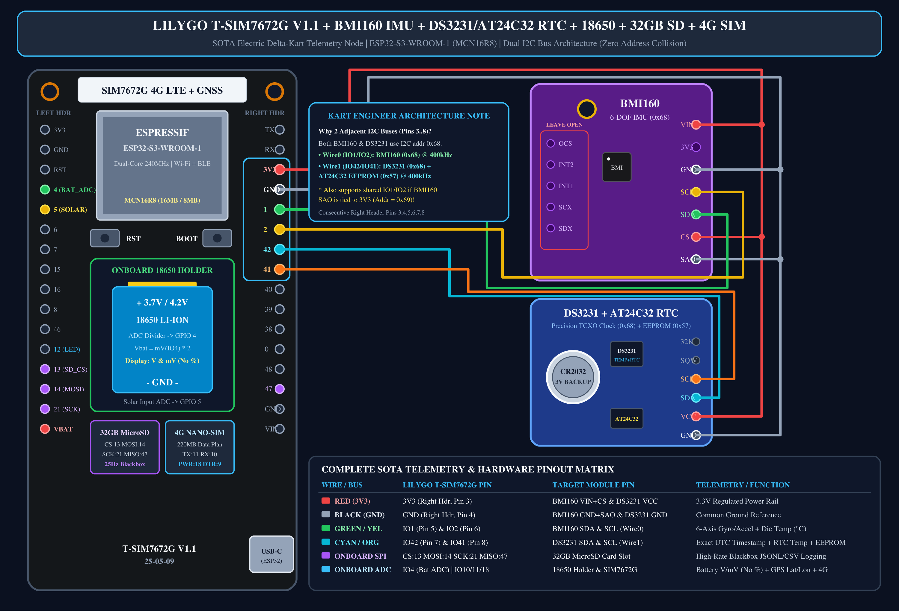
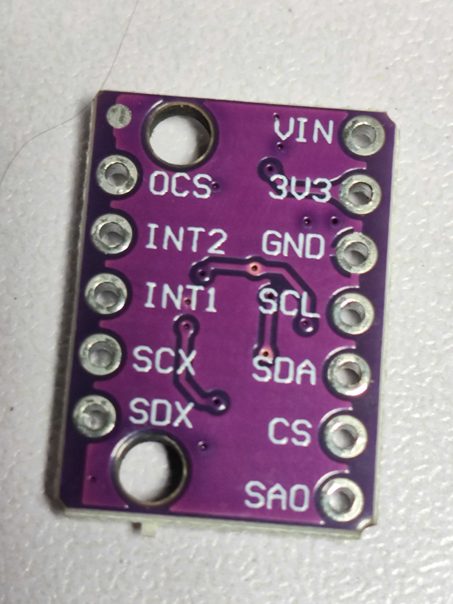
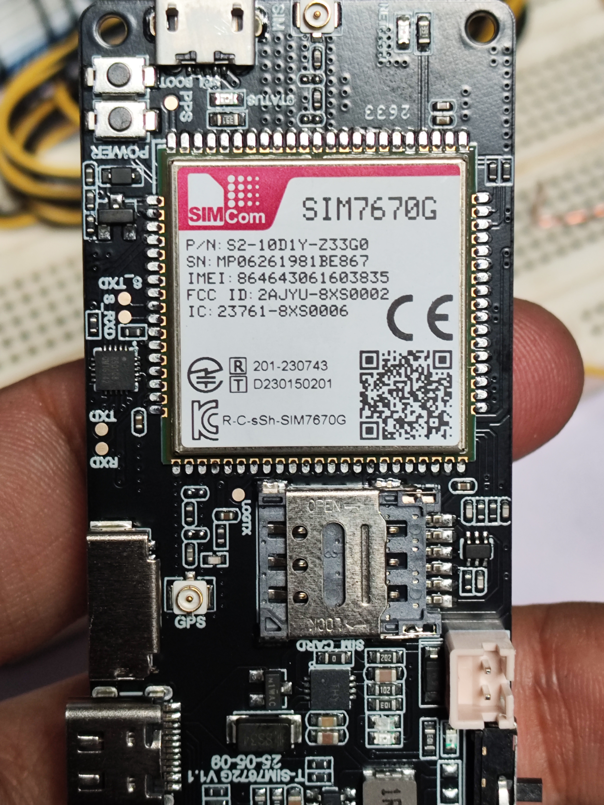
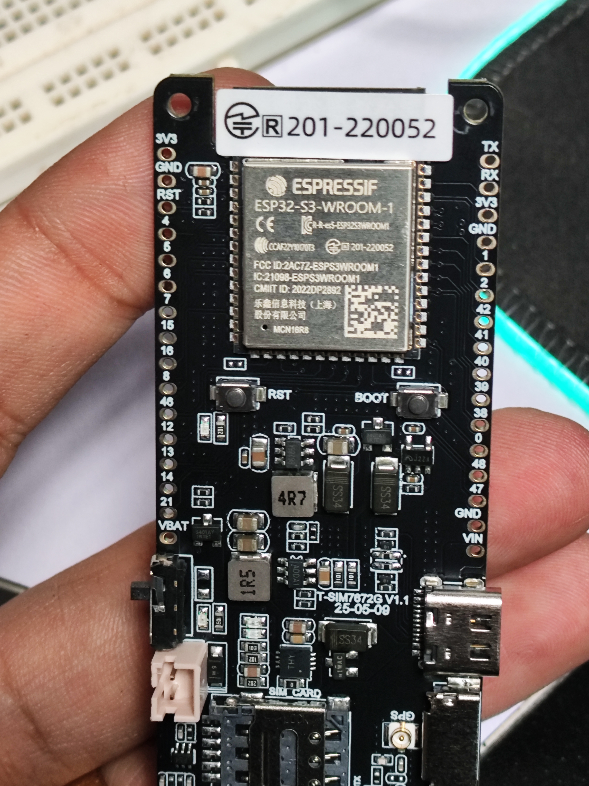

# 🏎️ Telemetría IoT SOTA para Delta-Kart Eléctrico y Dashboard 3D React Three Fiber

🌐 [English](README.md)

Sistema de telemetría IoT de alta frecuencia para un solo vehículo (Delta-Kart Eléctrico), modelo 3D paramétrico del chasis tubular de 30mm, mapa GPS oscuro Leaflet con superposición 3D en tiempo real, registro de caja negra con reloj TCXO DS3231 y sincronización adaptativa 4G LTE / Wi-Fi hacia Supabase para la placa **LilyGO T-SIM7672G V1.1 (ESP32-S3-WROOM-1 MCN16R8)**.

---

## 1. Arquitectura de Hardware (Un Solo Vehículo)

- **Microcontrolador Maestro**: **LilyGO T-SIM7672G V1.1** (`ESP32-S3-WROOM-1 MCN16R8`, Dual-Core 240MHz, `16MB Flash`, `8MB OPI PSRAM`).
- **Módem 4G LTE y Multi-GNSS**: **SIM7672G** 4G LTE Cat-1 + Multi-Constelación GNSS (`GPS + GLONASS + Galileo + BeiDou`) con control de alimentación LNA (`GPIO 4`).
- **Operador Celular**: **Movistar Colombia (Plan de Datos IoT de 220 MB)** con APN `internet.movistar.com.co` (>650 horas de conducción activa).
- **IMU Primaria 6-DOF**: **Bosch BMI160** (Giroscopio ±250 °/s, Acelerómetro ±2g, temperatura interna del chip °C) en **`Wire` Bus 0 (`SDA: GPIO 1`, `SCL: GPIO 2`)** a **400 kHz Fast-Mode**.
- **Reloj RTC de Precisión y EEPROM**: **Maxim DS3231SN/MZ TCXO** (±2ppm, `0x68`) + **EEPROM AT24C32 32Kbit** (`0x57`) con batería CR2032 en **`Wire1` Bus 1 (`SDA: GPIO 42`, `SCL: GPIO 41`)** a **400 kHz Fast-Mode** (Cero colisión de direcciones I2C).
- **Energía y Doble Perfil Térmico**: Portabatería **18650 Li-Ion** monitoreado en `GPIO 4` (reporta estrictamente `V` y `mV` reales, **sin porcentaje**) + entrada solar en `GPIO 5`.
- **Caja Negra Local**: Tarjeta **MicroSDHC de 32 GB** por SPI (`CS: 13, MOSI: 14, SCK: 21, MISO: 47`) registrando archivos CSV a **5 Hz (cada 200ms)** en `/logs/kart_session_XXXX.csv` (>11,000 horas).
- **Base de Datos en la Nube**: **Supabase PostgreSQL** (`kart_sessions`, `kart_telemetry` ~76 bytes/fila, `v_kart_live`) con trigger automático (`enforce_telemetry_storage_cap()`) que mantiene el almacenamiento bajo el límite gratuito de **500 MB**.

---

## 2. Esquema Eléctrico Completo y Fotos Reales del Montaje

| Foto de Montaje 1 | Foto de Montaje 2 | Foto de Montaje 3 |
| :---: | :---: | :---: |
|  |  |  |

---

## 3. Lista de Partes y BOM (Un Solo Vehículo — $69.50 USD)

| # | Componente | Especificación e Interfaz | Costo (USD) |
| :-: | :--- | :--- | :---: |
| **1** | **LilyGO T-SIM7672G V1.1** | ESP32-S3 (16MB/8MB) + SIM7672G 4G LTE Cat-1 + Multi-GNSS + Portabatería 18650 + MicroSD | **$45.00** |
| **2** | **Bosch BMI160 6-DOF IMU** | Giroscopio + Acelerómetro + Temp Interna (°C) en `Wire0` (`IO1/IO2` @ 400kHz) | **$2.50** |
| **3** | **DS3231SN TCXO RTC + AT24C32** | Reloj TCXO ±2ppm (`0x68`) + EEPROM (`0x57`) + CR2032 en `Wire1` (`IO42/IO41`) | **$2.20** |
| **4** | **Batería 18650 Li-Ion (3400mAh)** | Celda 3.7V / 4.2V monitoreada en `GPIO 4` ADC (`mV` y `V` reales, sin %) | **$3.50** |
| **5** | **Panel Solar (5V–6V 150mA)** | Carga solar auxiliar monitoreada en `GPIO 5` ADC | **$5.49** |
| **6** | **Tarjeta MicroSDHC 32 GB** | Almacenamiento SPI Clase 10 (`/logs/kart_session_XXXX.csv` a 5Hz) | **$5.80** |
| **7** | **SIM 4G Movistar + Arnés Dupont** | Plan IoT de 220 MB (`internet.movistar.com.co`) + Cables Dupont siliconados | **$5.01** |
| | **TOTAL (1 Vehículo)** | **Nodo Completo de Telemetría Delta-Kart** | **$69.50 USD** |
