# 🏎️ Telemetría IoT SOTA para Delta-Kart Eléctrico y Dashboard 3D React Three Fiber

🌐 [English](README.md)

Sistema de telemetría IoT de alta frecuencia para un solo vehículo (Delta-Kart Eléctrico), modelo 3D paramétrico del chasis tubular de 30mm, mapa GPS oscuro Leaflet con superposición 3D en tiempo real, registro de caja negra con reloj TCXO DS3231 y sincronización adaptativa 4G LTE / Wi-Fi hacia Supabase para la placa **LilyGO T-SIM7672G V1.1 (ESP32-S3-WROOM-1 MCN16R8)**.

[]()
[]()
[](https://0xraphael.com/college/iot-vehicle-telemetry)
[](https://github.com/0xrphl/iot-vehicle-telemetry)

---

## 1. Arquitectura de Hardware e Instrumentación (Un Solo Vehículo)

- **Microcontrolador Maestro**: **LilyGO T-SIM7672G V1.1** (`ESP32-S3-WROOM-1 MCN16R8`, Dual-Core 240MHz, `16MB Flash`, `8MB OPI PSRAM`).
- **Módem 4G LTE y Multi-GNSS**: **SIM7670G / SIM7672G** 4G LTE Cat-1 + Multi-Constelación GNSS (`GPS + GLONASS + Galileo + BeiDou`) con antena cerámica activa 28dBi polarizada a 3.3V (`AT+CGSETV=4,1`) y pin `RESET` (`GPIO 17` en `HIGH`).
- **Wi-Fi Dual Inteligente + Hotspot Local Concurrente (`WIFI_AP_STA`)**: Auto-escanea Wi-Fi primario y respaldo universitario (`utp` / `UTP`, credenciales en `secrets.h` ignorado por Git) hacia Supabase + NTP atómico, mientras emite simultáneamente **`Kart-Cal-Lab`** (`12345678`) en **`http://192.168.4.1/`** (Cubo 3D a 30 Hz + gráfica en tiempo real Temp/HR + laboratorio de calibración `/cal` sin dependencias CDN).
- **Bus 0 (`Wire`, 400 kHz) — IMU 6-DOF**: **Bosch BMI160** (`SDA: GPIO 1`, `SCL: GPIO 2`, `0x68`) a **30 Hz** con calibración estacionaria de bias y nivel 1g.
- **Bus 1 (`Wire1`, 100 kHz) — Reloj RTC y EEPROM**: **Maxim DS3231SN TCXO** (`0x68`, verificación genuina BCD + ajuste de cristal `Reg 0x10`) + **EEPROM AT24C32** (`0x57`) en `SDA: GPIO 42`, `SCL: GPIO 41`.
- **Bus 2 (Open-Drain I2C Dedicado, 100 kHz) — Ambiente**: **Sensirion SHT31-DIS Rojo de 4 Pines** (`SDA: GPIO 40`, `SCL: GPIO 39`, `0x44` + doble CRC-8 `0x31`) a **2 Hz** con calibración NVS, punto de rocío Magnus-Tetens, VPD y BIST de calefactor.
- **Bus 3 (Open-Drain I2C Dedicado, 100 kHz) — Monitor de Batería de Tracción 48V DC**: Texas Instruments **INA226 (16 bits) / INA228 (20 bits 85V)** (`SDA: GPIO 6`, `SCL: GPIO 7`, `VCC: 3V3`, `GND: GND`, `0x40`) a **20 Hz** midiendo tensión del banco de 48V (`V`), shunt (`mV`), corriente (`A`), potencia (`W`) y energía acumulada (`Wh` / `Ah`).
- **Bus 4 (Maxim 1-Wire) — Sondas Térmicas**: Sonda impermeable M12 **DS18B20** en **`GPIO 15`** (+ pull-up obligatoria de **`4.7 kΩ`** a `3V3`; auto-escanea pines libres `IO15, 16, 8`; evita `IO46`) soportando 1–2 sondas (`ds18_ctrl_c` Controlador y `ds18_motor_c` Motor) a 11 bits (`0.125°C`, `385ms` no bloqueante + CRC-8).
- **Energía y Caja Negra MicroSD 32 GB**: Batería **18650** (`GPIO 4` ADC en `V` y `mV` reales, sin %) + **MicroSD 32 GB** (`CS:13, MOSI:14, SCK:21, MISO:47`) preservando todos los CSVs en `/logs/` (5 Hz) y `/calibration/`.
- **Base de Datos en la Nube**: **Supabase PostgreSQL** (`kart_sessions`, `kart_telemetry`, `v_kart_live`) con auto-negociación de columnas y anillo `<500 MB`.

---

## 2. Esquema Eléctrico Completo y Fotos Reales del Montaje

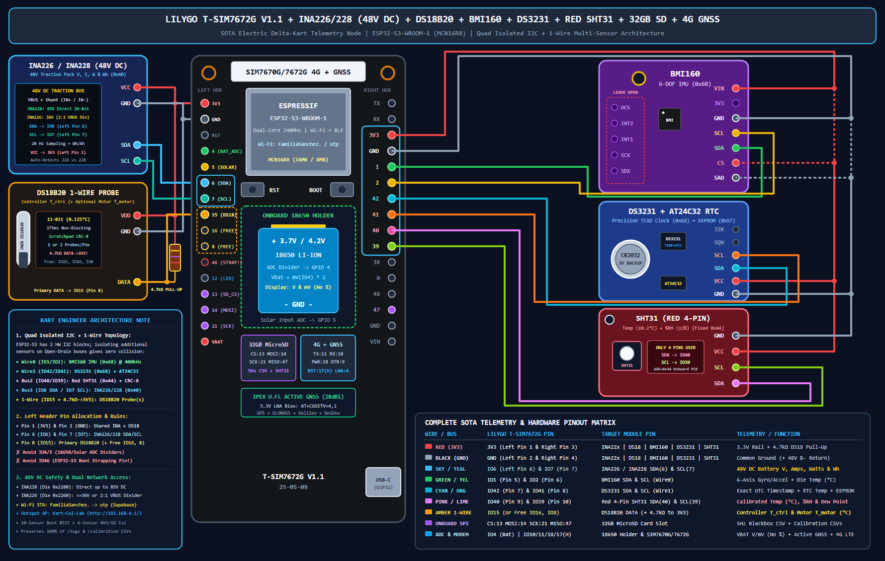

| Foto de Montaje 1 | Foto de Montaje 2 | Foto de Montaje 3 |
| :---: | :---: | :---: |
| 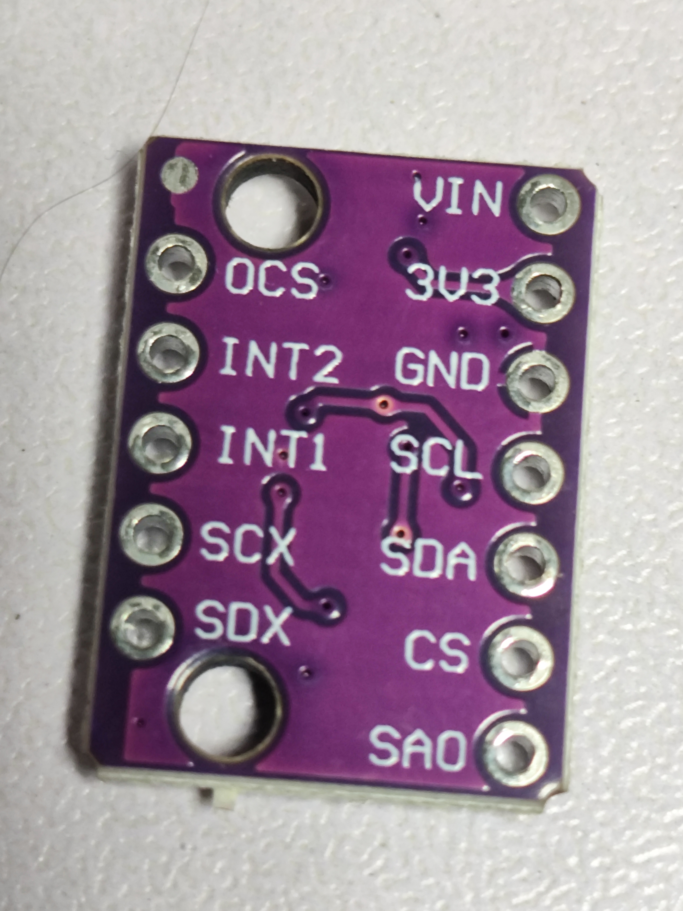 | 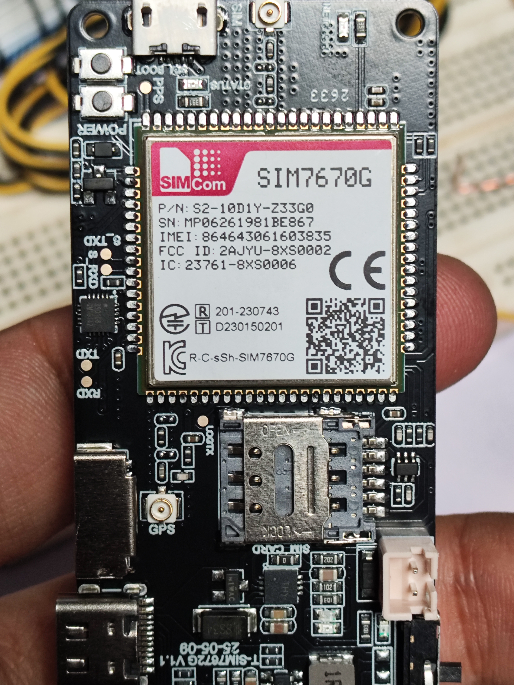 | 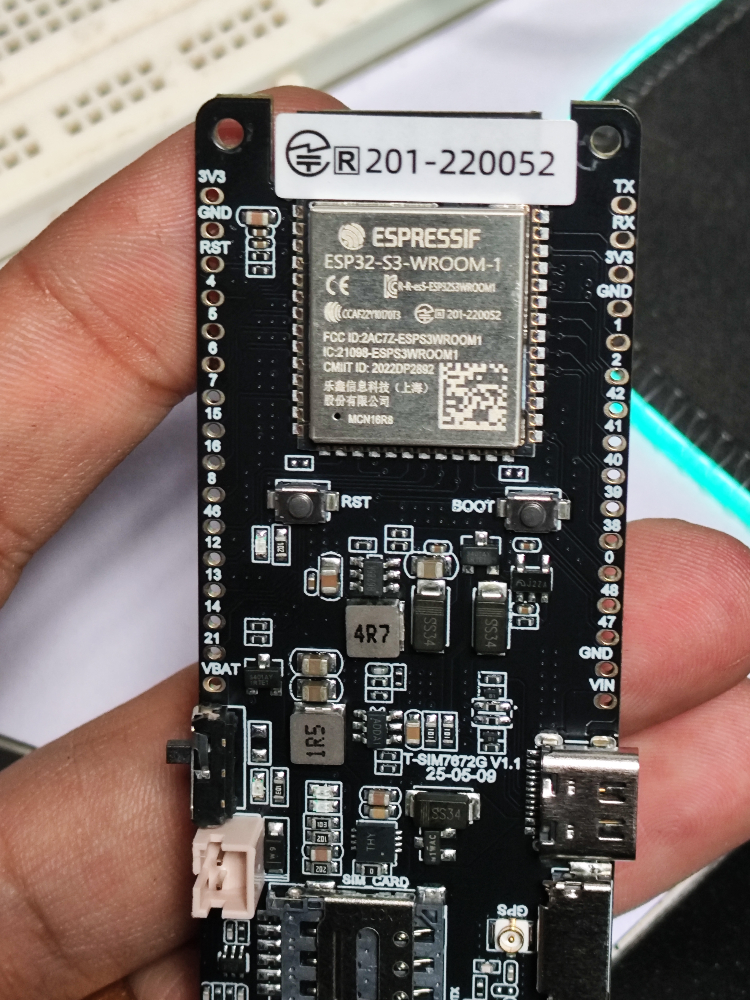 |

### Galería de Sensores, Abrazadera Axial PETG (Tubo 38.4mm) y Chasis Eléctrico

| Reporte de Partes y Stock | SHT31 Rojo 4 Pines (`IO40/39`) | Sonda M12 DS18B20 (`IO15`) |
| :---: | :---: | :---: |
| 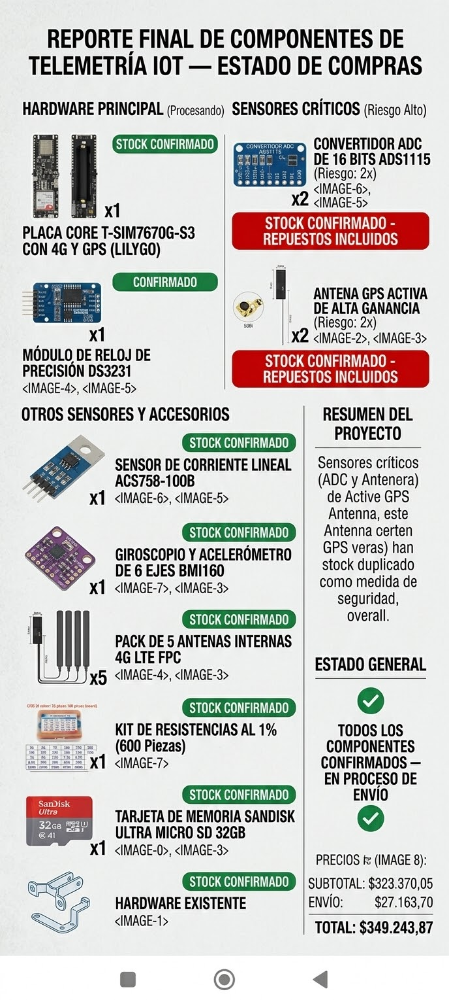 | 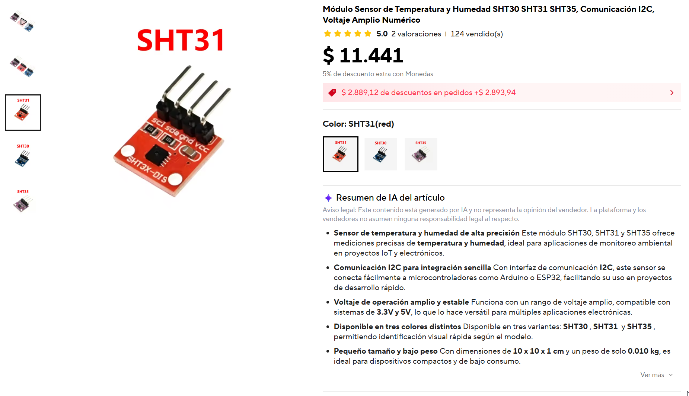 | 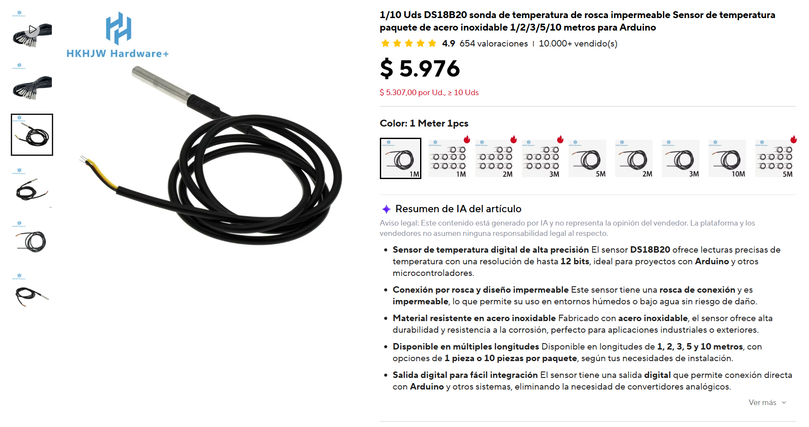 |

| Reloj DS3231 + AT24C32 (`IO42/41`) | CAD SolidWorks Sujeción 38.4mm | Laminado PETG 100% ElegooSlicer |
| :---: | :---: | :---: |
| 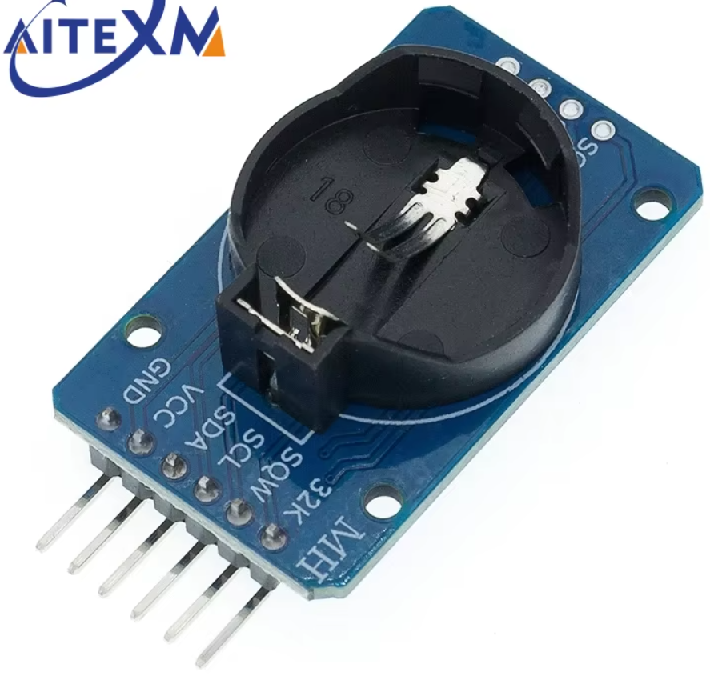 | 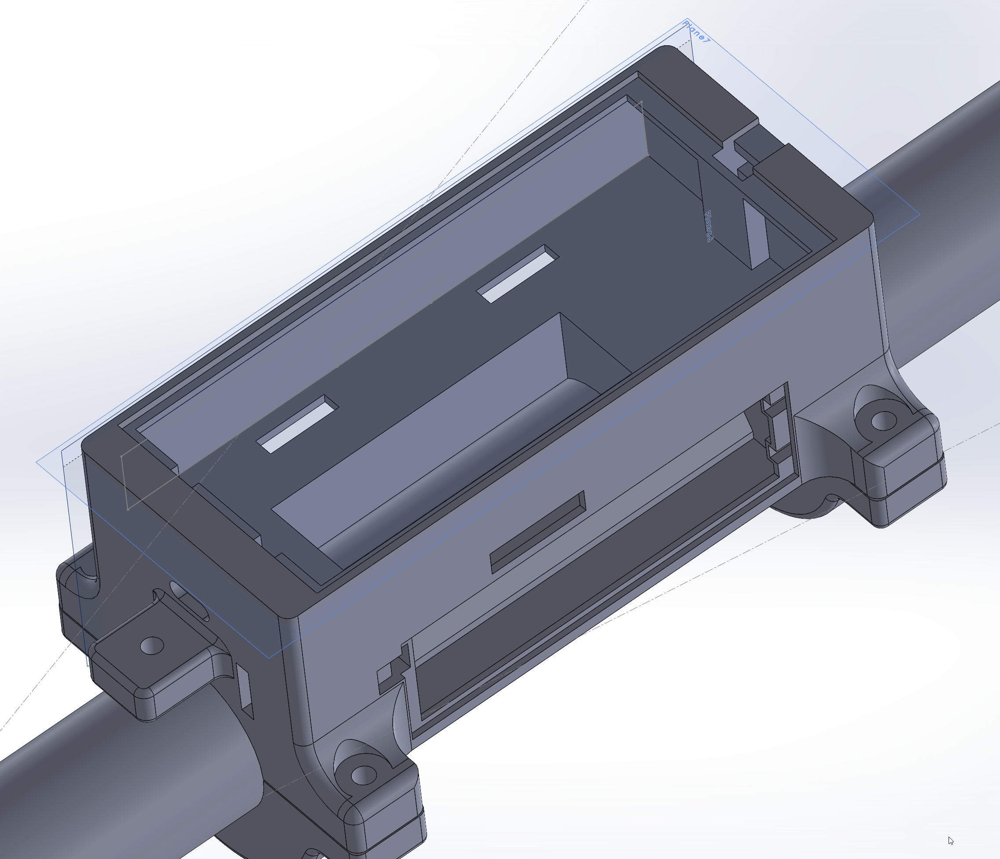 | 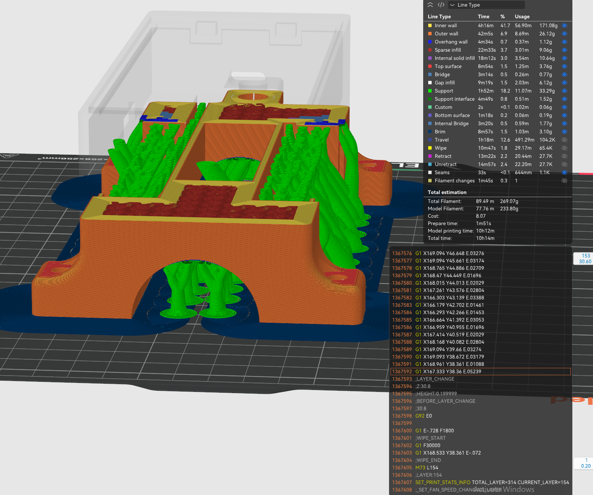 |

| Caja y Abrazadera Impresa en PETG | Geometría 3D de Tubos del Chasis | Chasis Tubular Real en Taller UTP |
| :---: | :---: | :---: |
| 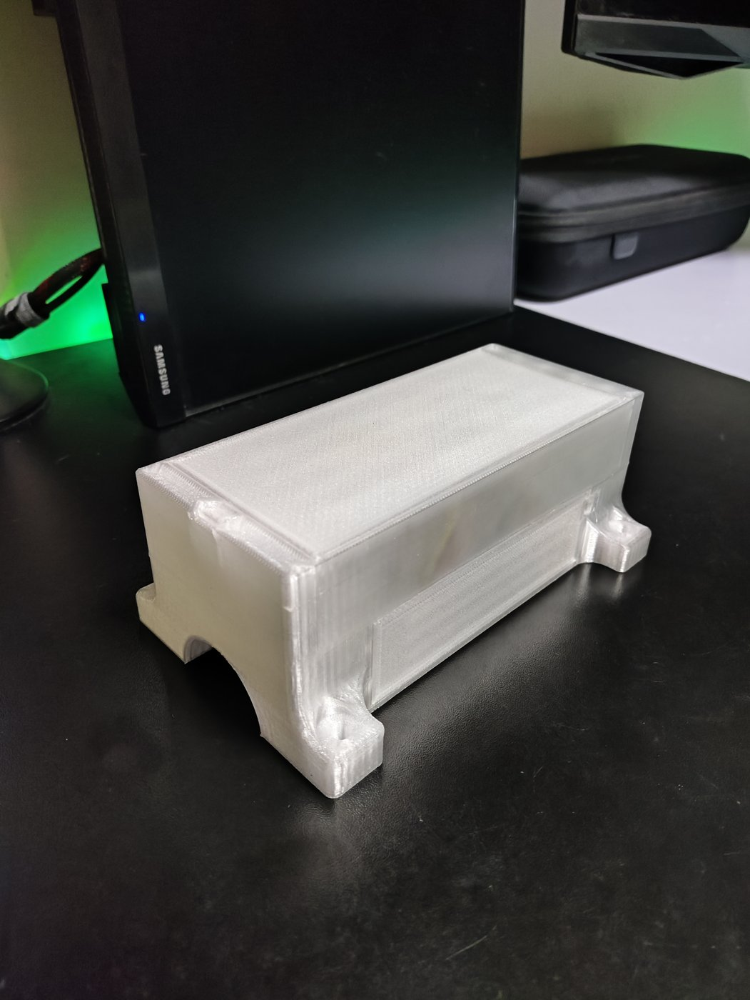 | 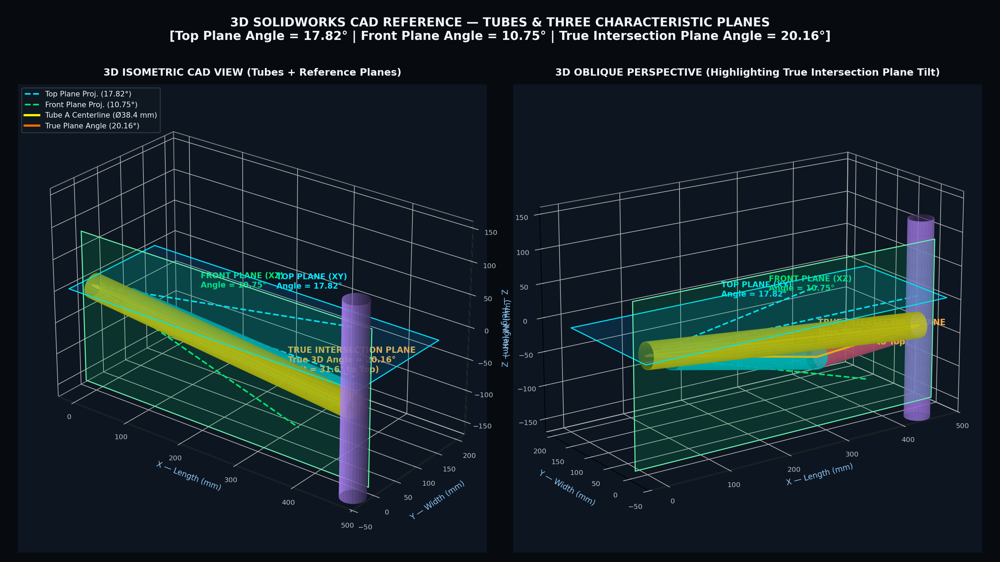 | 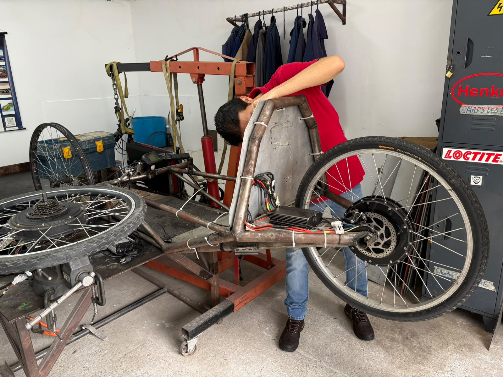 |

---

## 3. Lista de Partes y BOM (Un Solo Vehículo — $69.50 USD)

| # | Componente | Especificación e Interfaz | Costo (USD) |
| :-: | :--- | :--- | :---: |
| **1** | **LilyGO T-SIM7672G V1.1** | ESP32-S3 (16MB/8MB) + SIM7672G 4G LTE Cat-1 + Multi-GNSS + Portabatería 18650 + MicroSD | **$45.00** |
| **2** | **Bosch BMI160 6-DOF IMU** | Giroscopio + Acelerómetro + Temp Interna (°C) en `Wire0` (`IO1/IO2` @ 400kHz) | **$2.50** |
| **3** | **DS3231SN TCXO RTC + AT24C32** | Reloj TCXO ±2ppm (`0x68`) + EEPROM (`0x57`) + CR2032 en `Wire1` (`IO42/IO41`) | **$2.20** |
| **4** | **Batería 18650 Li-Ion (3400mAh)** | Celda 3.7V / 4.2V monitoreada en `GPIO 4` ADC (`mV` y `V` reales, sin %) | **$3.50** |
| **5** | **Panel Solar (5V–6V 150mA)** | Carga solar auxiliar monitoreada en `GPIO 5` ADC | **$5.49** |
| **6** | **Tarjeta MicroSDHC 32 GB** | Almacenamiento SPI Clase 10 (`/logs/kart_session_XXXX.csv` a 5Hz) | **$5.80** |
| **7** | **SIM 4G Movistar + Arnés Dupont** | Plan IoT de 220 MB (`internet.movistar.com.co`) + Cables Dupont siliconados | **$5.01** |
---

## 4. Arquitectura de Carpetas del Repositorio y Firmware Modular (`main/`)

Todo el código del ESP32-S3 reside dentro de **`main/`**, organizado en **4 pilares de ingeniería** (`sensors/`, `calibration/`, `boot_test/` y `local_dashboard/`), sincronizado de forma idéntica con el portafolio (`public/college/iot-vehicle-telemetry/firmware/`):

```text
iot-vehicle-telemetry/
├── .env / .env.example                  # Variables de entorno para Dashboard Three.js R3F, Bridge Python y Supabase
├── circuit_layout_full.{svg,png}        # Esquema eléctrico final 1780x1130 (4 buses I2C aislados + 1-Wire)
├── hardware_schematics/                 # Los 8 datasheets PDF oficiales + fotos PCB + esquemas
├── images/                              # Galería de sensores, sujeción PETG 38.4mm SolidWorks y chasis UTP
├── supabase/                            # schema.sql + SUPABASE_PENDING_COLUMNS_MIGRATION.sql
├── r3f_dashboard/                       # Dashboard Web 3D React Three Fiber + Leaflet (lee ../.env)
├── dashboard_server/                    # Puente local USB-Serial -> WebSocket en Python (lee ../.env)
└── main/                                # FIRMWARE MAESTRO ARDUINO ESP32-S3
    ├── main.ino                         # Punto único de entrada para flashear en Arduino IDE
    ├── config.h                         # Pines, struct KartTelemetry y valores seguros por defecto
    ├── secrets.h / secrets.example.h    # [IGNORADO POR GIT] Credenciales Wi-Fi, Hotspot, APN y Supabase
    ├── sensors/                         # 1. Drivers de sensores (BMI160, DS3231, SHT31, INA22x, DS18B20, GNSS, 18650, SD)
    ├── calibration/                     # 2. Curvas de calibración NVS + SD (/calibration/*.csv) para los 6 sensores
    ├── boot_test/                       # 3. Autoprueba de arranque de 10 subsistemas (self_test.h) + bench_sketches/
    └── local_dashboard/                 # 4. Dashboard local 30Hz (192.168.4.1), portal /cal y sincronización Supabase
```
