# 🏎️ SOTA IoT Electric Delta-Kart Telemetry & 3D React Three Fiber Dashboard

🌐 [Español](README.es.md)

High-frequency single-vehicle IoT telemetry system, parametric 30mm profile tube skeleton 3D model, dark-mode Leaflet GPS mapping with real-time 3D R3F Kart overlay, precision DS3231 TCXO RTC blackbox logging, and adaptive 4G LTE / Wi-Fi Supabase cloud synchronization for the **LilyGO T-SIM7672G V1.1 (ESP32-S3-WROOM-1 MCN16R8)**.

[]()
[]()
[](https://0xraphael.com/college/iot-vehicle-telemetry)
[](https://github.com/0xrphl/iot-vehicle-telemetry)

---

## 1. Single-Vehicle Hardware & Instrumentation Architecture

- **Microcontroller**: LilyGO T-SIM7672G V1.1 (`ESP32-S3-WROOM-1 MCN16R8`, Dual-Core 240MHz, `16MB Flash`, `8MB OPI PSRAM`).
- **Modem & Multi-GNSS**: SIMCom `SIM7670G / SIM7672G` 4G LTE Cat-1 + Multi-Constellation GNSS (`GPS + GLONASS + Galileo + BeiDou`) with active 28dBi ceramic antenna 3.3V LNA bias (`AT+CGSETV=4,1`) and active-LOW `RESET` (`GPIO 17` held `HIGH`).
- **Smart Dual Wi-Fi + Concurrent Local Hotspot (`WIFI_AP_STA`)**: Auto-scans primary Wi-Fi and campus fallback (`utp` / `UTP`, credentials loaded from gitignored `secrets.h`) for Supabase cloud sync + atomic NTP UTC, while simultaneously broadcasting **`Kart-Cal-Lab`** (`12345678`) at **`http://192.168.4.1/`** (zero-CDN 30 Hz 3D Cube + Live Temp/Humidity oscilloscope + `/cal` 6-sensor calibration lab).
- **Bus 0 (`Wire`, 400 kHz) — Primary IMU**: Bosch **BMI160** 6-DOF (`SDA: GPIO 1`, `SCL: GPIO 2`, `0x68`) @ **30 Hz** with stationary gyro bias & 1g level calibration.
- **Bus 1 (`Wire1`, 100 kHz) — Precision RTC & EEPROM**: Maxim **DS3231SN TCXO** (`0x68`, genuine BCD check + `Reg 0x10` crystal aging trim) + **AT24C32** EEPROM (`0x57`) on `SDA: GPIO 42`, `SCL: GPIO 41`.
- **Bus 2 (Dedicated Open-Drain I2C, 100 kHz) — Ambient Hygrometer**: **Red 4-Pin Sensirion SHT31-DIS** (`SDA: GPIO 40`, `SCL: GPIO 39`, fixed `0x44` + dual CRC-8 `0x31`) @ **2 Hz** with NVS calibration, Magnus-Tetens Dew Point, VPD, and 1.5s Heater BIST.
- **Bus 3 (Dedicated Open-Drain I2C, 100 kHz) — 48V DC Traction Pack Monitor**: Texas Instruments **INA226 (16-bit) / INA228 (20-bit 85V)** (`SDA: GPIO 6`, `SCL: GPIO 7`, `VCC: 3V3`, `GND: GND`, `0x40`) @ **20 Hz** measuring 48V pack voltage (`V`), shunt drop (`mV`), traction current (`A`), power (`W`), and cumulative energy (`Wh` / `Ah`).
- **Bus 4 (Maxim 1-Wire) — Powertrain Thermal Probes**: Waterproof M12 stainless **DS18B20** probe(s) on **`GPIO 15`** (+ mandatory `4.7 kΩ` pull-up to `3V3`; auto-scans free pins `IO15, 16, 8`; avoids strapping pin `IO46`) supporting 1–2 probes (`ds18_ctrl_c` Controller & `ds18_motor_c` Motor) at 11-bit (`0.125°C`, `385ms` non-blocking + Scratchpad CRC-8).
- **Power & Blackbox Storage**: Onboard **18650 Battery** (`GPIO 4` ADC in raw `V` & `mV`, no %) + **32 GB MicroSD** (`CS:13, MOSI:14, SCK:21, MISO:47`) preserving all `/logs/kart_session_XXXX.csv` (5 Hz) and `/calibration/*.csv` certificates.
- **Cloud Database**: **Supabase PostgreSQL** (`kart_sessions`, `kart_telemetry`, `v_kart_live`) with auto-negotiated schema compatibility & `<500 MB` free-tier ring-buffer trigger.

---

## 2. Full Hardware Wiring Schematic & Build Gallery

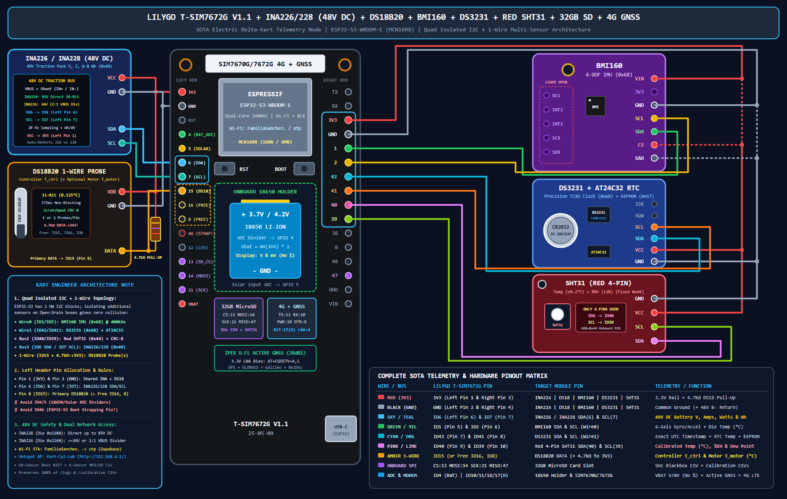

| Hardware Build Photo 1 | Hardware Build Photo 2 | Hardware Build Photo 3 |
| :---: | :---: | :---: |
| 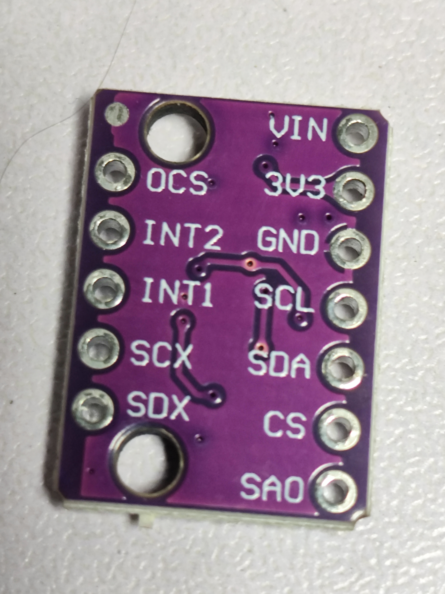 | 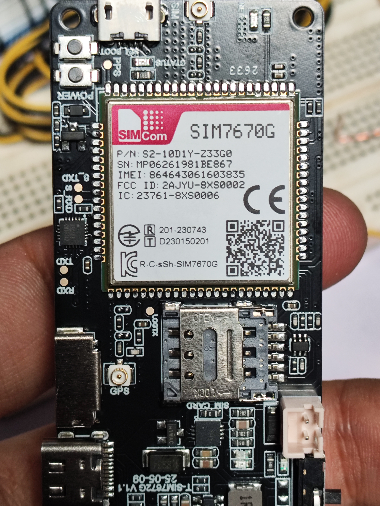 | 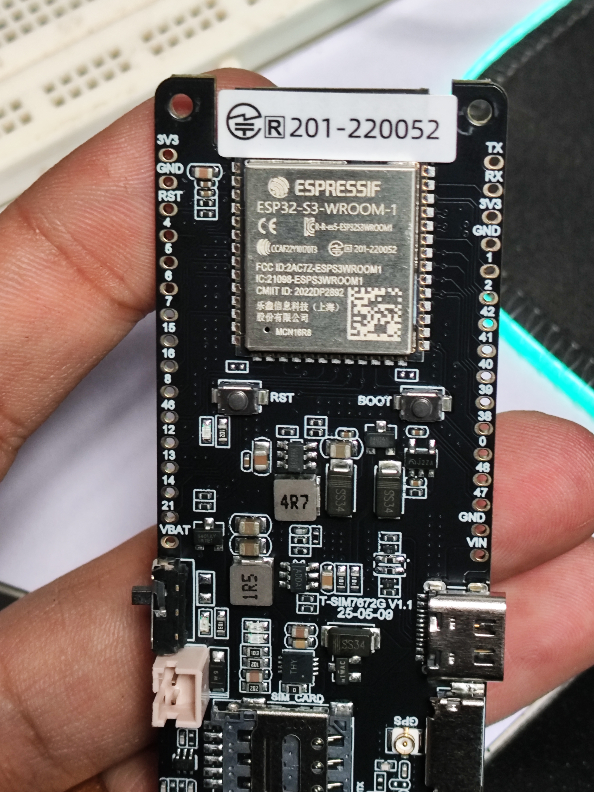 |

| Wire Color | LilyGO Pin (Header & Position) | Target Module Pin | Function |
| :--- | :--- | :--- | :--- |
| **RED** | **`3V3`** (Right Header, Pin 3) | BMI160 **`VIN`** & **`CS`**, DS3231 **`VCC`** | 3.3V Regulated Power Rail |
| **BLACK** | **`GND`** (Right Header, Pin 4) | BMI160 **`GND`** & **`SAO`**, DS3231 **`GND`** | Common Ground |
| **GREEN** | **`1`** (`GPIO 1`, Right Header Pin 5) | BMI160 **`SDA`** (`Wire` Bus 0) | I2C Data (400 kHz) |
| **YELLOW** | **`2`** (`GPIO 2`, Right Header Pin 6) | BMI160 **`SCL`** (`Wire` Bus 0) | I2C Clock (400 kHz) |
| **CYAN** | **`42`** (`GPIO 42`, Right Header Pin 7) | DS3231 **`SDA`** (`Wire1` Bus 1) | RTC & EEPROM Data (100 kHz) |
| **ORANGE** | **`41`** (`GPIO 41`, Right Header Pin 8) | DS3231 **`SCL`** (`Wire1` Bus 1) | RTC & EEPROM Clock (100 kHz) |
| **PINK / VIOLET** | **`40`** (`GPIO 40`, Right Header Pin 9) | Red 4-Pin SHT31 **`SDA`** (`Bus2` Open-Drain) | Calibrated Temp (°C), %RH & Dew Point (`0x44`) |
| **LIME** | **`39`** (`GPIO 39`, Right Header Pin 10) | Red 4-Pin SHT31 **`SCL`** (`Bus2` Open-Drain) | Dedicated 100 kHz Clock + Dual CRC-8 |
| **SKY / TEAL** | **`6 & 7`** (`GPIO 6 / 7`, Left Hdr Pins 6 & 7) | TI INA226 / INA228 **`SDA(6)`** & **`SCL(7)`** | 48V DC Traction Battery `V`, `A`, `W` & `Wh` (`0x40`) |
| **AMBER** | **`15`** (`GPIO 15`, Left Hdr Pin 8 — or free `16,8`) | DS18B20 **`DATA`** (+ **`4.7 kΩ`** pull-up to `3V3`) | 1-Wire Controller `T_ctrl` & Motor `T_motor` (°C) |
| *Internal* | **`4`** (`GPIO 4`, Left Header Pin 4) | 18650 Battery Voltage Divider | `vbat_mv = analogReadMilliVolts(4) * 2` |
| *Internal* | **`5`** (`GPIO 5`, Left Header Pin 5) | Solar Bus Voltage Divider | `solar_mv = analogReadMilliVolts(5) * 2` |
| *Internal* | **`13, 14, 21, 47`** | 32 GB MicroSD SPI Slot | `CS=13, MOSI=14, SCK=21, MISO=47` |
| *Internal* | **`10, 11, 18, 9, 17(HIGH)`** | SIM7670G/7672G 4G LTE & Active GNSS | `TX=11, RX=10, PWR=18, DTR=9, RST=17(H), LNA=4` |

### Sensors, 3D-Printed PETG Axial Clamp (38.4mm Tube) & Electric Chassis Gallery

| Confirmed Parts & Stock | Red 4-Pin SHT31 (`IO40/39`) | Waterproof M12 DS18B20 (`IO15`) |
| :---: | :---: | :---: |
| 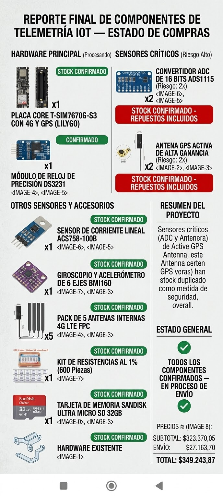 | 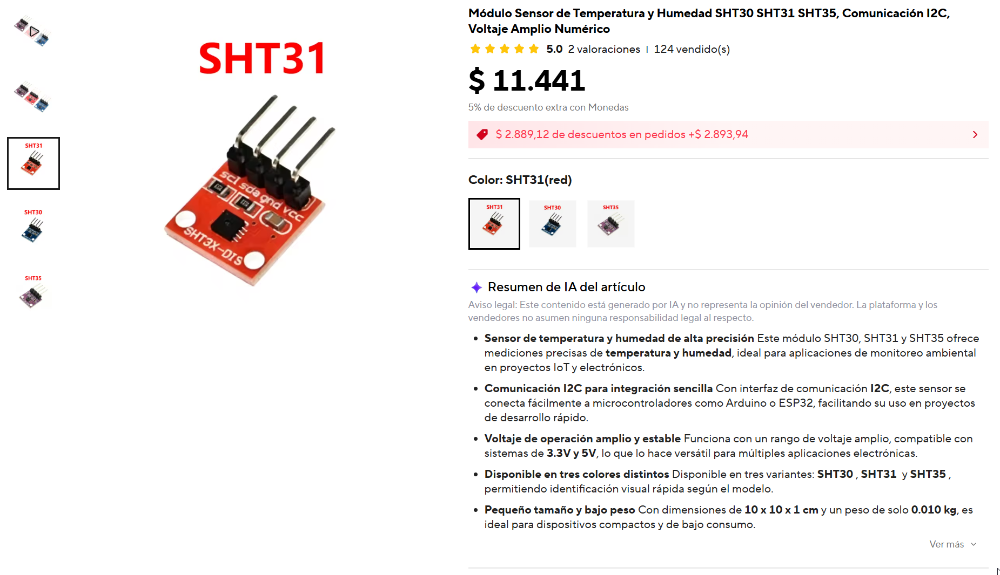 | 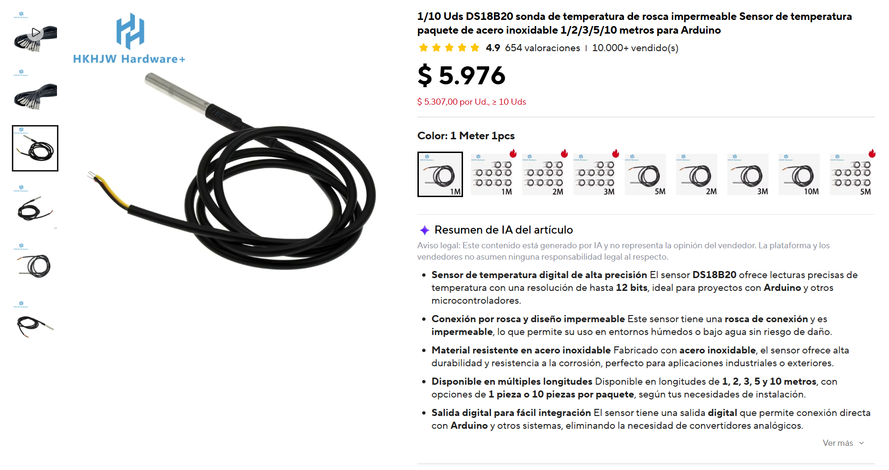 |

| DS3231 + AT24C32 RTC (`IO42/41`) | SolidWorks 38.4mm Tube Clamp CAD | ElegooSlicer 100%-Infill PETG |
| :---: | :---: | :---: |
| 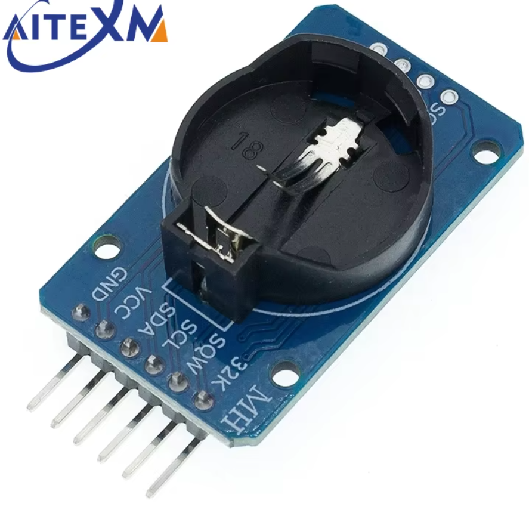 | 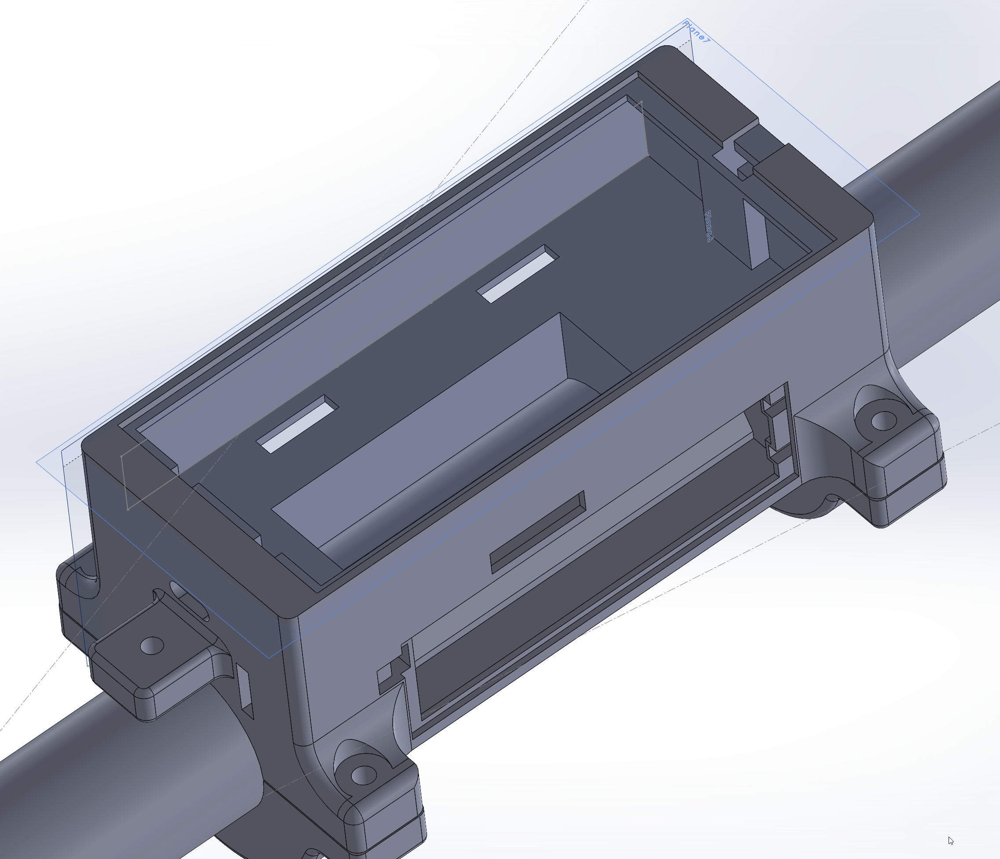 | 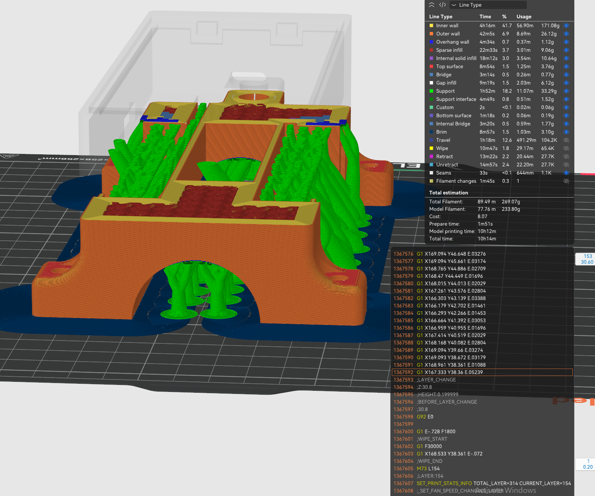 |

| 3D-Printed PETG Enclosure Build | 3D CAD Chassis Tube Geometry | Electric Kart Tubular Chassis (UTP) |
| :---: | :---: | :---: |
| 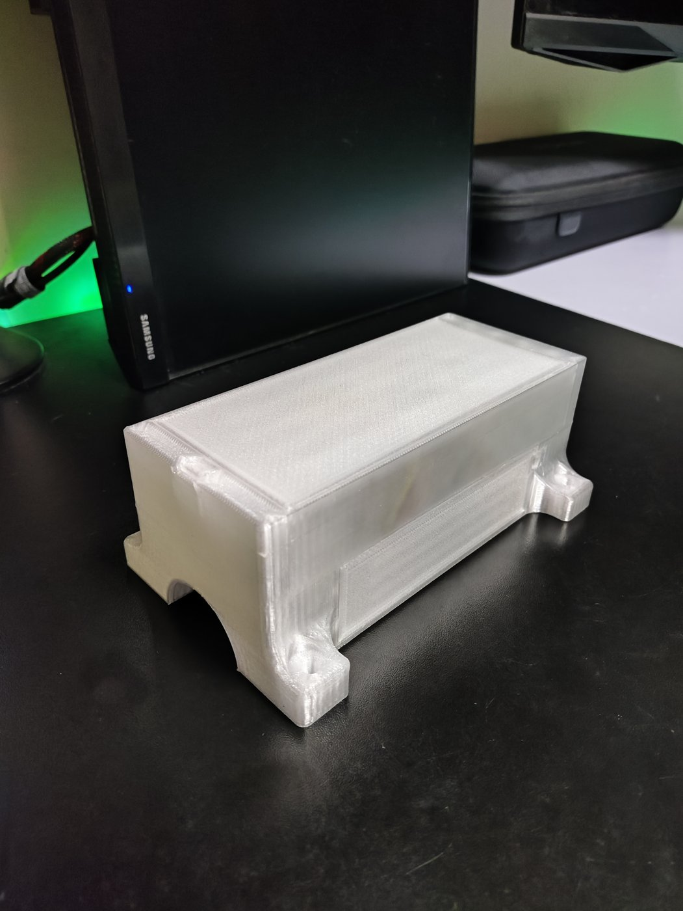 | 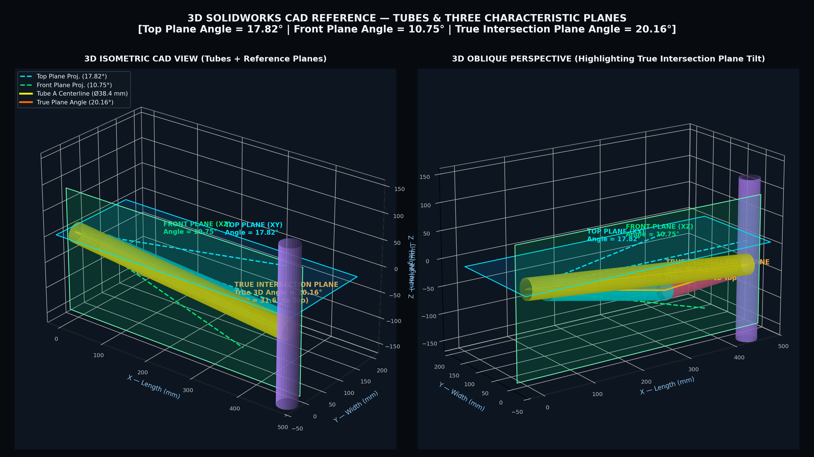 | 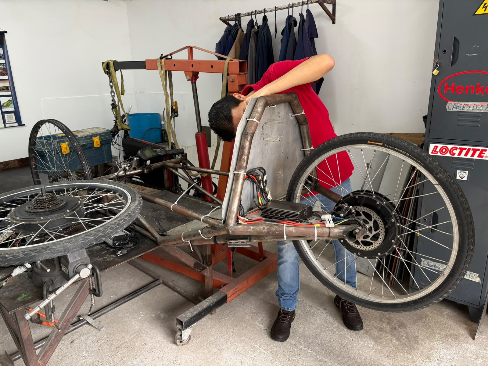 |

---

## 3. Single-Vehicle Bill of Materials (BOM — $69.50 USD)

| # | Component | Key Specs & Interface | Price (USD) |
| :-: | :--- | :--- | :---: |
| **1** | **LilyGO T-SIM7672G V1.1** | ESP32-S3 (16MB/8MB) + SIM7672G 4G LTE Cat-1 + Multi-GNSS + 18650 Holder + MicroSD Slot | [**$45.00**](https://aliexpress.com/item/1005007058444056.html) |
| **2** | **Bosch BMI160 6-DOF IMU** | 3-axis Gyro + 3-axis Accel + Die Temp (°C) on `Wire0` (`IO1/IO2` @ 400kHz) | [**$2.50**](https://www.aliexpress.us/item/3256809462979321.html) |
| **3** | **DS3231SN TCXO RTC + AT24C32** | ±2ppm TCXO Clock (`0x68`) + 32Kbit EEPROM (`0x57`) + CR2032 on `Wire1` (`IO42/IO41`) | **$2.20** |
| **4** | **18650 Li-Ion Cell (3400mAh)** | 3.7V / 4.2V cell in onboard holder (`GPIO 4` ADC raw `mV`/`V`, no %) | **$3.50** |
| **5** | **Solar Panel (5V–6V 150mA)** | Auxiliary solar charging connected to `GPIO 5` ADC divider | [**$5.49**](https://es.aliexpress.com/item/1005005825496564.html) |
| **6** | **32 GB MicroSDHC Card** | Class 10 SPI blackbox storage (`/logs/kart_session_XXXX.csv` @ 5Hz) | **$5.80** |
| **7** | **Movistar 4G SIM + Harness** | 220 MB IoT plan (`internet.movistar.com.co`) + Silicone Dupont harness | **$5.01** |
| **8** | **Sensirion SHT31-DIS (Red 4-Pin)** | ±0.2°C / ±2%RH I2C (`0x44`) on `IO40/IO39` + CRC-8 + Dew Point | **$2.80** |
| **9** | **DS18B20 M12 Waterproof Probe + 4.7kΩ** | Stainless 1-Wire probe (`IO15` + `4.7kΩ` to `3V3`, 11-bit CRC-8) | **$2.40** |
| | **TOTAL (Single-Vehicle Node)** | **Complete Production Telemetry & Multi-Sensor Instrumentation Build** | **$74.70 USD** |


---

## 3. Quick Start: Flashing the Master Firmware (`main/main.ino`)

### Unified Repository & Modular Firmware Folder Schema

All ESP32-S3 firmware lives cleanly inside **`main/`**, organized into **4 modular engineering pillars** (`sensors/`, `calibration/`, `boot_test/`, and `local_dashboard/`) — mirrored 100% identically between this standalone telemetry repository and the embedded portfolio firmware (`public/college/iot-vehicle-telemetry/firmware/`):

```text
iot-vehicle-telemetry/
├── .env / .env.example                  # Vite Three.js R3F Dashboard + Python Bridge + Supabase env vars
├── circuit_layout_full.{svg,png}        # Final 1780x1130 Quad-I2C + 1-Wire vector & PNG schematic
├── hardware_schematics/                 # All 8 official PDF datasheets (SIM7672X, INA228, SHT31, DS18B20, BMI160, DS3231, AT24C32, FNIRSI)
├── images/                              # Hardware build, SolidWorks PETG 38.4mm clamp, SHT31, DS18B20 & UTP chassis gallery
├── supabase/                            # schema.sql + SUPABASE_PENDING_COLUMNS_MIGRATION.sql
├── r3f_dashboard/                       # Three.js / React Three Fiber + Dark Leaflet Web Dashboard (reads ../.env)
├── dashboard_server/                    # Local USB-Serial -> WebSocket Python bridge (reads ../.env)
│
└── main/                                # MASTER ARDUINO ESP32-S3 FIRMWARE
    ├── main.ino                         # Single entry point: open in Arduino IDE & click Upload!
    ├── config.h                         # Hardware pinout matrix, KartTelemetry struct & safe fallback defaults
    ├── secrets.h / secrets.example.h    # [GITIGNORED] Local Wi-Fi, Hotspot, SIM APN & Supabase keys
    │
    ├── sensors/                         # 1. ALL HARDWARE SENSOR, MODEM, POWER & SD DRIVERS
    │   ├── imu_bmi160.h                 # Bosch BMI160 6-DOF Gyro/Accel (Wire0: IO1/IO2 @ 400kHz, 30 Hz)
    │   ├── rtc_ds3231.h                 # Maxim DS3231 TCXO RTC + AT24C32 EEPROM (Wire1: IO42/IO41)
    │   ├── env_sht31.h                  # Red 4-Pin Sensirion SHT31-DIS (Bus2 Open-Drain: IO40/IO39, 2 Hz)
    │   ├── power_ina22x.h               # TI INA226/INA228 48V DC Battery Monitor (Bus3: IO6/IO7, 20 Hz)
    │   ├── temp_ds18b20.h               # Waterproof DS18B20 1-Wire Probe(s) (IO15 + 4.7kΩ pull-up, 1 Hz)
    │   ├── gps_sim7672.h                # SIM7670G/7672G 4G LTE + Active 28dBi Multi-GNSS (1 Hz)
    │   ├── power_18650.h                # Onboard 18650 Battery & Solar ADC (IO4/IO5, raw V & mV)
    │   └── sd_logger.h                  # 32GB MicroSD 5Hz Blackbox & Calibration CSV Logger
    │
    ├── calibration/                     # 2. MULTI-SENSOR CALIBRATION CURVES & NVS/SD PERSISTENCE
    │   ├── calibration_manager.h        # Master 6-sensor NVS + SD `/calibration/*.csv` orchestrator
    │   ├── ina22x_48v_cal/              # 48V Shunt Ohms, VBUS divider, Zero-A Tare & Multimeter trim
    │   ├── sht31_env_cal/               # 1-pt/2-pt Temp/%RH OLS, Magnus Dew Point & Heater BIST
    │   ├── ds18b20_probe_cal/           # Controller/Motor 1-Wire trim & ROM role swap
    │   ├── imu_bmi160_cal/              # 150-sample stationary Gyro Zero-Bias, 1g Level & 3D Tare
    │   ├── rtc_ds3231_cal/              # Atomic NTP UTC sync, PPM drift & Reg 0x10 Crystal Aging trim
    │   └── gps_gnss_cal/                # UTP Geodetic Benchmark & CEP50/CEP95 scatter analyzer
    │
    ├── boot_test/                       # 3. PARAMETRIC BOOT SELF-TEST (BIST) & BENCH DIAGNOSTICS
    │   ├── self_test.h                  # 10-Subsystem Boot & Live BIST Engine (`kart_sessions.test`)
    │   └── bench_sketches/              # Optional standalone single-sensor `.ino` bench tools
    │       ├── ina22x_48v_cal_test/ina22x_48v_cal_test.ino
    │       ├── sht31_gps_cal_test/sht31_gps_cal_test.ino
    │       └── rtc_troubleshoot/rtc_troubleshoot.ino
    │
    └── local_dashboard/                 # 4. LOCAL ESP32 REAL-TIME WEB UI, CAL PORTAL & CLOUD SYNC
        ├── embedded_dashboard.h         # Zero-CDN 30Hz 3D Cube + Live Temp/RH Chart (`http://192.168.4.1/`)
        ├── calibration_portal.h         # Interactive 6-Sensor Web Calibration Lab (`http://192.168.4.1/cal`)
        ├── MinWebSockets.h              # Lightweight RFC-6455 WebSocket Server (Port 81)
        └── telemetry_sync.h             # Dual Wi-Fi + `Kart-Cal-Lab` AP_STA + Supabase Cloud Dispatcher
```

### Flashing Steps:
1. Open **Arduino IDE**.
2. Verify `main/secrets.h` is present (or copy `main/secrets.example.h` $\rightarrow$ `main/secrets.h` with your Wi-Fi & Supabase credentials).
3. Open [`main/main.ino`](./main/main.ino).
3. Board Configuration (`Tools` menu):
   - **Board**: `ESP32S3 Dev Module`
   - **USB CDC On Boot**: `Enabled`
   - **Flash Size**: `16MB (128Mb)`
   - **Flash Mode**: `QIO 80MHz`
   - **PSRAM**: `OPI PSRAM`
   - **Upload Speed**: `921600`
4. In `main/config.h`, set your Supabase URL & Key (see [`SUPABASE_SETUP.md`](./SUPABASE_SETUP.md)).
5. Click **Upload**.

---

## 4. Running the SOTA React Three Fiber + Leaflet Dashboard

1. Launch with one click:
   Double-click [`dashboard_server/run_dashboard.bat`](./dashboard_server/run_dashboard.bat).
   *(Or in terminal: `cd r3f_dashboard && npm run dev`)*
2. Open your browser at:
   - **React Three Fiber Dashboard**: `http://localhost:5173`
   - **Vanilla Glassmorphism Fallback**: `http://localhost:8080`
   - **Network Access**: `http://192.168.1.8:5173` (from phone/tablet on Wi-Fi).

### Dashboard Highlights:
- **3D Kart Assembly**: Parametric **30 mm profile tube skeleton** (2 steerable front wheels, 1 rear drive wheel) divided into modular files (`TubeSegment`, `MainLadderFrame`, `FrontSuspensionArms`, `RearSwingarmSubframe`, `RollCageAndCockpit`, `KartWheels`).
- **Dark Leaflet Map**: Displays GPS path breadcrumbs with a **3D Three.js Kart overlaid directly on top of the GPS coordinate**, pitching, rolling, and yawing in real time.
- **Power & Thermals**: 18650 Battery voltage in `V` and `mV` (no %), BMI160 Gyro Temp (°C), and DS3231 RTC Temp (°C).
- **Test Track Drive Button**: Generates dynamic track laps to test the full 3D kart and GPS map integration even when indoors!
