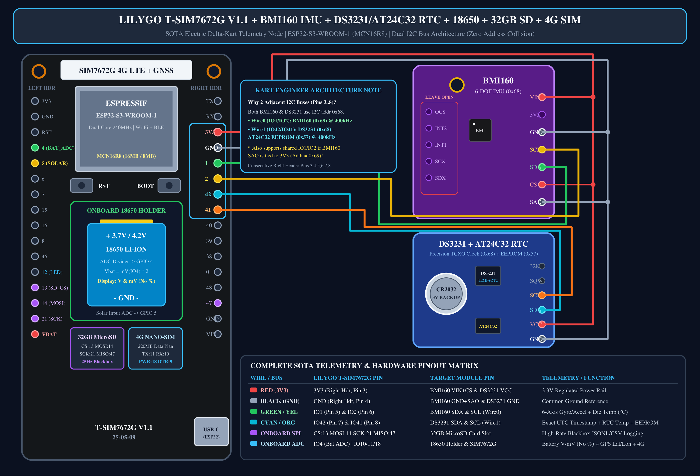
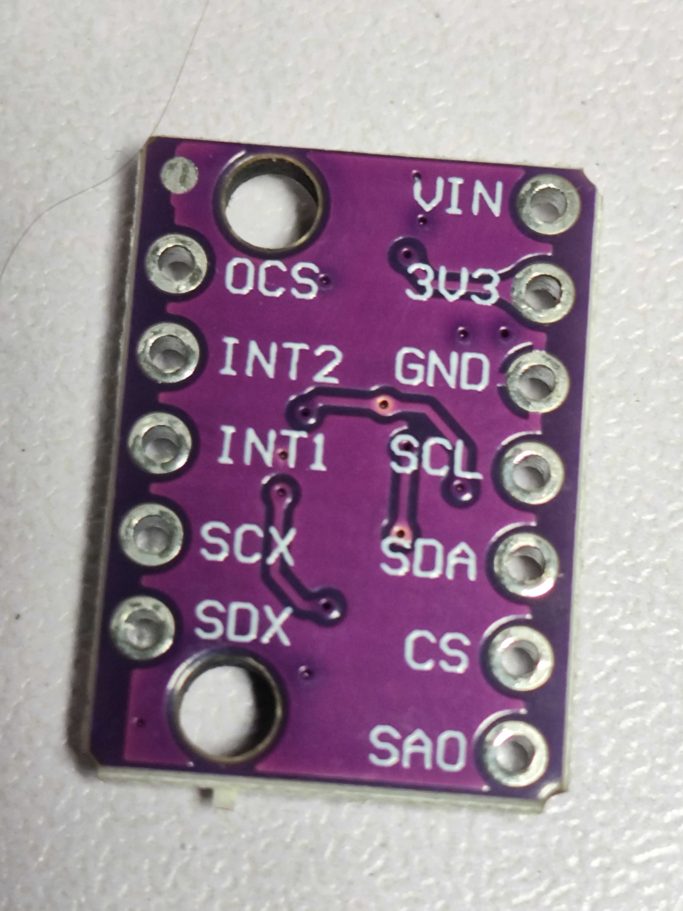
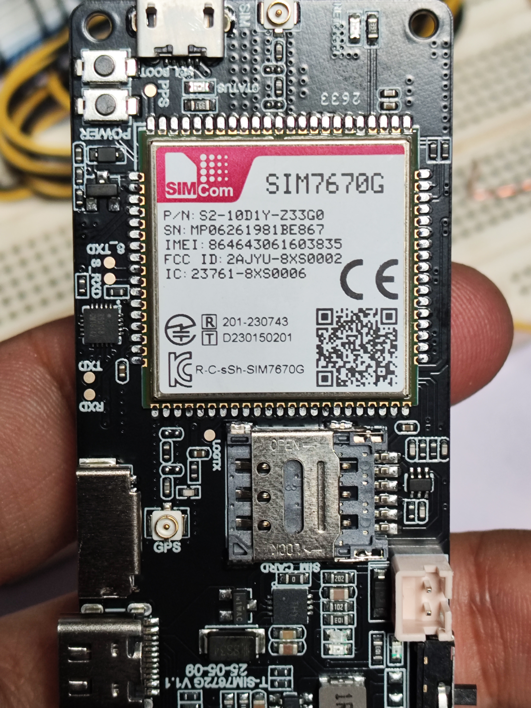
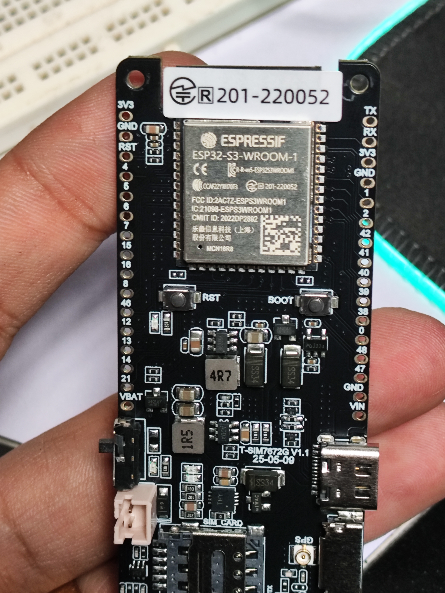

# 🏎️ SOTA IoT Electric Delta-Kart Telemetry & 3D React Three Fiber Dashboard

🌐 [Español](README.es.md)

High-frequency single-vehicle IoT telemetry system, parametric 30mm profile tube skeleton 3D model, dark-mode Leaflet GPS mapping with real-time 3D R3F Kart overlay, precision DS3231 TCXO RTC blackbox logging, and adaptive 4G LTE / Wi-Fi Supabase cloud synchronization for the **LilyGO T-SIM7672G V1.1 (ESP32-S3-WROOM-1 MCN16R8)**.

---

## 1. Single-Vehicle Hardware Architecture & Features

- **Microcontroller**: LilyGO T-SIM7672G V1.1 (`ESP32-S3 Dual-Core 240MHz`, `16MB Flash`, `8MB OPI PSRAM`).
- **Modem & GNSS**: SIM7672G 4G LTE-CAT1 + Multi-Constellation GNSS (GPS + GLONASS + Galileo + BeiDou) with internal LNA antenna power control (`GPIO 4`).
- **Cellular Carrier**: **Movistar Colombia (220 MB Data Plan)** configured with APN `internet.movistar.com.co`.
- **Primary IMU**: Bosch BMI160 6-DOF (Gyroscope ±250 °/s, Accelerometer ±2g, internal die temperature °C) on **`Wire` (SDA: `GPIO 1`, SCL: `GPIO 2`)** at **400 kHz Fast-Mode**.
- **RTC & EEPROM**: Maxim DS3231MZ/SN TCXO Real-Time Clock (±2ppm accuracy) + AT24C32 32Kbit EEPROM on **`Wire1` (SDA: `GPIO 42`, SCL: `GPIO 41`)** at **400 kHz Fast-Mode**.
  - *Kart Engineer Zero-Collision Bus Design*: Runs on adjacent Right Header pins (`IO42` and `IO41`), eliminating any I2C address conflict with the BMI160 at `0x68`.
- **Power System**: Onboard **18650 Li-Ion Battery Holder** monitored through `GPIO 4` ADC hardware voltage divider (displays raw `V` and `mV`, strictly no percentage). Solar input monitored through `GPIO 5`.
- **Local Storage**: 32 GB MicroSD Card SPI slot (`CS: 13, MOSI: 14, SCK: 21, MISO: 47`) logging full-rate CSV blackbox files to `/logs/kart_session_XXXX.csv`.
- **Cloud Database**: **Supabase PostgreSQL** optimized for the **500 MB Free Tier limit** with automatic ring-buffer pruning.

---

## 2. Full Hardware Wiring Schematic & Build Gallery

| Hardware Build Photo 1 | Hardware Build Photo 2 | Hardware Build Photo 3 |
| :---: | :---: | :---: |
|  |  |  |

| Wire Color | LilyGO Pin (Header & Position) | Target Module Pin | Function |
| :--- | :--- | :--- | :--- |
| **RED** | **`3V3`** (Right Header, Pin 3) | BMI160 **`VIN`** & **`CS`**, DS3231 **`VCC`** | 3.3V Regulated Power Rail |
| **BLACK** | **`GND`** (Right Header, Pin 4) | BMI160 **`GND`** & **`SAO`**, DS3231 **`GND`** | Common Ground |
| **GREEN** | **`1`** (`GPIO 1`, Right Header Pin 5) | BMI160 **`SDA`** (`Wire` Bus 0) | I2C Data (400 kHz) |
| **YELLOW** | **`2`** (`GPIO 2`, Right Header Pin 6) | BMI160 **`SCL`** (`Wire` Bus 0) | I2C Clock (400 kHz) |
| **CYAN** | **`42`** (`GPIO 42`, Right Header Pin 7) | DS3231 **`SDA`** (`Wire1` Bus 1) | RTC & EEPROM Data (400 kHz) |
| **ORANGE** | **`41`** (`GPIO 41`, Right Header Pin 8) | DS3231 **`SCL`** (`Wire1` Bus 1) | RTC & EEPROM Clock (400 kHz) |
| *Internal* | **`4`** (`GPIO 4`, Left Header Pin 4) | 18650 Battery Voltage Divider | `vbat_mv = analogReadMilliVolts(4) * 2` |
| *Internal* | **`5`** (`GPIO 5`, Left Header Pin 5) | Solar Bus Voltage Divider | `solar_mv = analogReadMilliVolts(5) * 2` |
| *Internal* | **`13, 14, 21, 47`** | 32 GB MicroSD SPI Slot | `CS=13, MOSI=14, SCK=21, MISO=47` |
| *Internal* | **`10, 11, 18, 9`** | SIM7672G 4G LTE & GNSS | `TX=11, RX=10, PWRKEY=18, DTR=9` |

---

## 3. Single-Vehicle Bill of Materials (BOM — $69.50 USD)

| # | Component | Key Specs & Interface | Price (USD) |
| :-: | :--- | :--- | :---: |
| **1** | **LilyGO T-SIM7672G V1.1** | ESP32-S3 (16MB/8MB) + SIM7672G 4G LTE Cat-1 + Multi-GNSS + 18650 Holder + MicroSD Slot | [**$45.00**](https://aliexpress.com/item/1005007058444056.html) |
| **2** | **Bosch BMI160 6-DOF IMU** | 3-axis Gyro + 3-axis Accel + Die Temp (°C) on `Wire0` (`IO1/IO2` @ 400kHz) | [**$2.50**](https://www.aliexpress.us/item/3256809462979321.html) |
| **3** | **DS3231SN TCXO RTC + AT24C32** | ±2ppm TCXO Clock (`0x68`) + 32Kbit EEPROM (`0x57`) + CR2032 on `Wire1` (`IO42/IO41`) | **$2.20** |
| **4** | **18650 Li-Ion Cell (3400mAh)** | 3.7V / 4.2V cell in onboard holder (`GPIO 4` ADC raw `mV`/`V`, no %) | **$3.50** |
| **5** | **Solar Panel (5V–6V 150mA)** | Auxiliary solar charging connected to `GPIO 5` ADC divider | [**$5.49**](https://es.aliexpress.com/item/1005005825496564.html) |
| **6** | **32 GB MicroSDHC Card** | Class 10 SPI blackbox storage (`/logs/kart_session_XXXX.csv` @ 5Hz) | **$5.80** |
| **7** | **Movistar 4G SIM + Harness** | 220 MB IoT plan (`internet.movistar.com.co`) + Silicone Dupont harness | **$5.01** |
| | **TOTAL (Single-Vehicle Node)** | **Complete Production Telemetry Build** | **$69.50 USD** |

---

## 3. Quick Start: Flashing the Master Firmware

1. Open **Arduino IDE**.
2. Open [`main/main.ino`](./main/main.ino).
3. Board Configuration (`Tools` menu):
   - **Board**: `ESP32S3 Dev Module`
   - **USB CDC On Boot**: `Enabled`
   - **Flash Size**: `16MB (128Mb)`
   - **Flash Mode**: `QIO 80MHz`
   - **PSRAM**: `OPI PSRAM`
   - **Upload Speed**: `921600`
4. In `main/config.h`, set your Supabase URL & Key (see [`SUPABASE_SETUP.md`](./SUPABASE_SETUP.md)).
5. Click **Upload**.

---

## 4. Running the SOTA React Three Fiber + Leaflet Dashboard

1. Launch with one click:
   Double-click [`dashboard_server/run_dashboard.bat`](./dashboard_server/run_dashboard.bat).
   *(Or in terminal: `cd r3f_dashboard && npm run dev`)*
2. Open your browser at:
   - **React Three Fiber Dashboard**: `http://localhost:5173`
   - **Vanilla Glassmorphism Fallback**: `http://localhost:8080`
   - **Network Access**: `http://192.168.1.8:5173` (from phone/tablet on Wi-Fi).

### Dashboard Highlights:
- **3D Kart Assembly**: Parametric **30 mm profile tube skeleton** (2 steerable front wheels, 1 rear drive wheel) divided into modular files (`TubeSegment`, `MainLadderFrame`, `FrontSuspensionArms`, `RearSwingarmSubframe`, `RollCageAndCockpit`, `KartWheels`).
- **Dark Leaflet Map**: Displays GPS path breadcrumbs with a **3D Three.js Kart overlaid directly on top of the GPS coordinate**, pitching, rolling, and yawing in real time.
- **Power & Thermals**: 18650 Battery voltage in `V` and `mV` (no %), BMI160 Gyro Temp (°C), and DS3231 RTC Temp (°C).
- **Test Track Drive Button**: Generates dynamic track laps to test the full 3D kart and GPS map integration even when indoors!
